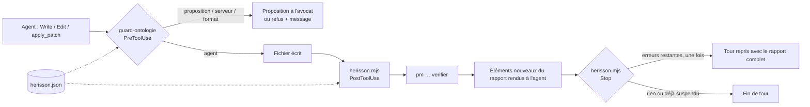

# Le Hérisson : registre et vérification automatique

Le Hérisson est la feature centrale qui garde et vérifie les écritures de l'agent.
Il fait partie du [Harness Legal](harness-legal.md).

Un seul registre décrit les fichiers que l'agent écrit dans `.piecemaker/` :
`server/piecemaker/vendor/piecemaker-plugin/herisson.json`. Deux hooks le
lisent, pour tous les clients (Claude, Codex, Vibe, chat Mistral de l'app) :

- **avant l'écriture** (PreToolUse) : `guard-ontologie.mjs` transforme en
  proposition, ou refuse, l'écriture des features gardées. Le message renvoyé
  à l'agent est le `motif` du registre. Pour une feature à `format`, il
  calcule le fichier tel qu'il serait après l'écriture (Write, Edit,
  MultiEdit, apply_patch) et le contrôle. Une faute nouvelle bloque
  l'écriture : rien n'est écrit, l'agent reçoit les fautes avec leur ligne.
  Une faute déjà présente ne bloque pas, pour laisser l'agent la corriger ;
- **après l'écriture** (PostToolUse) : `herisson.mjs` lance le
  vérificateur `pm` de la feature touchée. Il ne rend à l'agent que les
  éléments du rapport qu'il n'a pas déjà rendus pendant le tour (40 lignes
  au plus). Un rapport inchangé ne rend rien ;
- **après une commande** (PostToolUse sur le shell) : une commande qui
  correspond à la `commande` d'une feature lance aussi son vérificateur. Avec
  `cite`, il est lancé pour chaque programme Catala du dossier dont un fichier
  contient ce texte ;
- **en fin de tour** (Stop) : `herisson.mjs` relance les vérifications
  encore en erreur et suspend la fin de tour une seule fois, avec le rapport
  complet. L'agent corrige, ou cite à l'avocat ce qu'il ne peut pas corriger.
  Elle est aussi suspendue, une seule fois, quand le sous-agent
  `research-maker` lancé pendant le tour n'a pas rendu son compte rendu (Claude seulement).

Le Hérisson garde l'état du tour dans un fichier temporaire par dossier
(`<dossier temporaire>/piecemaker-herisson/<empreinte du dossier>.json`) :
pour chaque vérification, son dernier rapport et s'il signale une erreur. La
fin de tour efface ce fichier. Pour Claude, les hooks `SubagentStart` et
`SubagentStop` de `herisson.mjs` notent à côté, dans
`<empreinte du dossier>.agents/<agent_id>`, chaque sous-agent PieceMaker lancé
et pas encore terminé ; la fin de tour efface aussi ce dossier.

Un élément du rapport est une ligne non indentée avec ses lignes indentées.
Deux éléments sont les mêmes si seuls leur numéro d'ordre et leurs numéros
de ligne diffèrent. Le champ `erreur` du registre dit si une sortie signale
une erreur : les vérificateurs `pm` rendent aussi un texte quand tout est
conforme.

Les sous-agents gardent leur propre contrôle de fin : `verify-subagent.mjs`
(inchangé).



## Fonctionnement par feature

| Feature | Fichiers (sous `.piecemaker/`) | Écriture | Avant (PreToolUse) | Après (PostToolUse) | Skill | Délai |
|---|---|---|---|---|---|---|
| `ontologie` | `ontologie.json` (dans `~/.piecemaker`), `ontologie.proposition.json` | proposition | devient une proposition (onglet Case index › Ontologie) | — | `okf` | — |
| `okf` | `okf/**` | agent | Write ou Edit | après une écriture d'un concept : `pm okf verify` (validateur Context-OKF strict : erreurs et lints) | `okf` | 30 s |
| `etapes` | `etapes.json` | serveur | refusée : l'avocat règle les étapes sur le tableau | — | `piecemaker` | — |
| `protection` | `protection.json` | serveur | refusée : l'avocat lève la protection par le bouclier | — | `piecemaker` | — |
| `suivi` | `<nom>-suivi.json`, `suivi.json` | agent | refusée si le JSON est illisible ou si la racine n'a pas la forme `matter`, `evenements`, `echeances` | `pm suivi_dossiers verifier --suivi <fichier>` | `piecemaker` | 60 s |
| `timeline` | brain : `goals/<goal>/Timeline.json` | agent | refusée si la racine n'a pas la forme `actes`, `matter`, `evenements`, `echeances` ou si un acte existant change | `pm suivi_dossiers verifier --suivi <goal>-suivi.json` | `piecemaker` | 60 s |
| `goal` | brain : `goals/<goal>/Goal.md`, `Memory.md` | agent | refusée avec un frontmatter ou au-delà de 200 lignes (renvoi vers `Archive.md`) | — | `piecemaker` | — |
| `case-timeline` | brain : `Timeline.json` du dossier | serveur | refusée : étape et synthèse sont écrites par le serveur | — | `piecemaker` | — |
| `memoire` | `memoires/<nom>.md` (mémoire projet, règle 4°) | agent | refusée si l'écriture ajoute un frontmatter | `pm memoire verifier --memoire <nom>` : un acte du même nom (voir [suivi-dossier.md](suivi-dossier.md)) | `piecemaker` | 10 s |
| `catala` | `catala/<nom>/*.catala_fr`, `*.toml` | agent | refusée si l'écriture ajoute une faute de format (`.catala_fr` seulement) ou une erreur de compilation, ou crée un programme au nom absent des raisonnements de `etapes.json` | `pm catala verifier --programme <nom>` | `catala` | 60 s |
| `revue` | aucun fichier : brouillon de revue tabulaire | agent | libre | après `pm tabular_review preparer` ou `lancer` : `pm tabular_review verifier` (recherches en erreur ou à compléter) | `piecemaker` | 30 s |

## Messages renvoyés à l'agent

Texte exact. Entre `<…>` : la partie variable. Un retour à la ligne du message
est noté `⏎`.

Les messages du Hérisson sont en anglais technique simple. La sortie des
vérificateurs `pm`, reprise telle quelle, reste en français.

| Feature | Moment | Cas | Texte exact |
|---|---|---|---|
| `ontologie` | PreToolUse | Edit, Write ou apply_patch accepté | `Edit saved as a proposal in ontologie.proposition.json. ontologie.json does not change, this is normal: the lawyer accepts, refuses or modifies each change in the Case index › Ontologie tab.⏎Compared with the current ontology: relations — <changes>; document types — <changes>.⏎To add to it, edit ontologie.json again: each edit is added to the pending proposal.` |
| `ontologie` | PreToolUse | proposition partie du fichier actuel (3e ligne remplacée) | `The pending proposal did not contain the replaced text: the new proposal starts from the current file and replaces the old proposal.` |
| `ontologie` | PreToolUse | proposition invalide | `Proposal not saved, nothing changed: <reason>. Correct the cause, then edit <file> again.` |
| `ontologie` | PreToolUse | serveur arrêté (raison) | `PieceMaker is not running, the proposal cannot be checked; ask the lawyer to start PieceMaker` |
| `ontologie` | PreToolUse | écriture par le shell | `Only the lawyer sets the link ontology (~/.piecemaker/ontologie.json, common to all cases), in the Case index › Ontologie tab. Read it with pm okf ontologie. To propose a change, edit ontologie.json with the Edit or Write tool (or apply_patch), never with the shell: the edit becomes a proposal and the lawyer decides.` |
| `ontologie` | PreToolUse | accès à la clé de sceau `ontologie.cle` | `Only the PieceMaker server can access the seal key of the ontology (~/.piecemaker/ontologie.cle).` |
| `ontologie` | PreToolUse | écriture d'une proposition en attente (`*.proposition.json`) | le texte « écriture par le shell » de la feature |
| `etapes` | PreToolUse | toute écriture | `Only the lawyer sets the case steps (.piecemaker/etapes.json), on the board of the Suivi des dossiers tab. Read the current step and the document to produce with pm check. Never write this file. To change a step, ask the lawyer.` |
| `protection` | PreToolUse | toute écriture | `Only the PieceMaker server writes the document protection file (.piecemaker/protection.json). Only the lawyer removes the protection, with the shield of the case in the sidebar. Never write this file. Read the converted Markdown of a protected document, not the PDF or the image.` |
| `suivi` | PreToolUse | faute de forme nouvelle | `Write refused by Le Hérisson: the tracking file does not have the expected structure. Nothing was written.⏎<file>:<line>: <error>⏎    line <line> is: <texte de la ligne>⏎…⏎Correct these lines, then write the file again. Full model: Feature read deadlines path=piecemaker/references/suivi.md.` |
| `memoire` | PreToolUse | frontmatter ajouté | `Write refused by Le Hérisson: the project memory does not have the expected structure. Nothing was written.⏎<file>:1: frontmatter is not permitted: the memory starts with a block between two "---" lines. Remove this block. Deadlines go in .piecemaker/<name>-suivi.json. The lawyer sets the current step and the document to produce on the board of the Suivi des dossiers tab: read them with pm check.⏎Correct the memory, then write it again: plain Markdown, no frontmatter.` |
| `catala` | PreToolUse | faute de format ou erreur de compilation nouvelle | `Write refused by Le Hérisson: the program does not follow the Catala format or does not compile. Nothing was written.⏎<file>:<line>: <error>⏎    line <line> is: <texte de la ligne>⏎…⏎Correct only the lines shown, keep the rest of the file, then write again. Start from the model of references/format.md (catala skill), which compiles; its table "Fautes fréquentes" gives the fix of common errors.` — 10 fautes au plus, puis `… <N> more error(s).` Une erreur de compilation s'écrit `<file>:<line>: compilation: <message du compilateur>` ; `<file>` peut être un autre fichier du programme, par exemple le test qui utilise un champ renommé. Un nouveau programme (dossier sans autre `.catala_fr`) dont le nom n'est pas un raisonnement de `etapes.json` (hors `remplacePar`) est refusé : `<file>:1: program name "<nom>" is not a reasoning of the case. Use the exact name given by pm check: .piecemaker/catala/<nom attendu>/.` |
| `revue` | PostToolUse | recherche bloquée (sortie de `pm tabular_review verifier`) | `Recherche « <nom> » : bloquée → pm tabular_review lister`, dans le message de vérification ci-dessous |
| toutes les features vérifiées | PostToolUse | le rapport contient des éléments nouveaux et signale une erreur | `Automatic check (<feature>): pm <arguments>⏎<éléments nouveaux>⏎<N> report item(s) were already shown above and did not change. They are not repeated. The items that report an error or a gap must still be corrected.⏎⏎Correct each error or gap in the file and at the line shown. Do not run this verifier yourself: Le Hérisson runs it after each write and gives the full report at the end of the turn.` — la ligne `<N> report item(s)…` est absente si rien n'est omis ; 40 lignes au plus, puis `… <N> more line(s).` |
| toutes les features vérifiées | PostToolUse | éléments nouveaux, sans erreur | `Automatic check (<feature>): pm <arguments>⏎<éléments nouveaux>⏎<N> report item(s) were already shown above and did not change. They are not repeated.`, sans consigne |
| toutes les features vérifiées | PostToolUse | sortie vide ou rapport inchangé | aucun message |
| toutes les features vérifiées | Stop | une vérification du tour signale encore une erreur | `End of turn stopped by Le Hérisson: <N> check(s) still report errors or gaps in files that you wrote during this turn.⏎⏎Automatic check (<feature>): pm <arguments>⏎<rapport complet>⏎⏎Correct each error or gap in the file and at the line shown, then finish. If you cannot correct an item (document missing from the case, decision that belongs to the lawyer), do not correct it: quote it as is to the lawyer in your final answer. The end of turn will not be stopped a second time.` |
| toutes les features vérifiées | Stop | plus d'erreur, ou fin de tour déjà suspendue | aucun message |
| sous-agents PieceMaker (Claude) | Stop | un sous-agent lancé pendant le tour n'a pas rendu son compte rendu | `End of turn stopped by Le Hérisson: <N> PieceMaker subagent(s) started during this turn did not give their report (<agents>).⏎⏎Do the work that the lawyer asked for in this turn: wait for each report, or run the subagent again in the foreground and use its report. Do not schedule a wake-up and do not suspend the work. If the lawyer stopped a subagent, do not run it again. The end of turn will not be stopped a second time.` — avec des vérifications en erreur, les deux causes sont jointes par `; ` dans la première ligne, les rapports suivent, puis les deux consignes dans le dernier paragraphe |
| `memoire` | PostToolUse | frontmatter déjà présent avant l'écriture (sortie de `pm memoire verifier`, dans le message de vérification ci-dessus) | `.piecemaker/memoires/<nom>.md:1: erreur : pas de frontmatter. Les échéances vont dans .piecemaker/<nom>-suivi.json ; l’étape en cours et le document à produire sont sur le tableau de l’onglet Suivi des dossiers (pm check). Reportez-y ses données, puis retirez le frontmatter.` |
| `memoire` | PostToolUse | aucun acte du même nom (idem) | `.piecemaker/memoires/<nom>.md : manque : aucun raisonnement, programme Catala, suivi ni carte du tableau ne s’appelle <nom>. Nommez la mémoire comme son acte.` |
| `memoire` | PostToolUse | mémoire conforme | aucun message |

Fautes de forme du suivi (`<faute>` ci-dessus), données par `suiviErrors` de
`scripts/lib/herisson.mjs` :

| Faute | Texte exact |
|---|---|
| JSON illisible | `JSON illisible : <message de l'analyseur>. Réécrivez un JSON valide : guillemets doubles, pas de virgule finale, pas de commentaire.` |
| racine non objet | `le suivi est un objet { "matter": {…}, "evenements": { "nom de l’événement": {…} }, "echeances": { "nom de l’échéance": {…} } }, pas une liste.` (ou `pas une valeur seule.`) |
| clé de racine inconnue | `clé « <clé> » inconnue à la racine du suivi. Clés admises : matter, evenements, echeances. Placez son contenu sous l’une d’elles ou retirez-la.` |
| `matter`, `evenements` ou `echeances` non objet | `« <clé> » est un objet { "nom en français": {…} }, pas une liste.` (pour `matter` : `{ "client": …, "summary": … }`) |

Fautes de format Catala (`<faute>` ci-dessus), données par
`catala-documentation.mjs` :

| Faute | Texte exact |
|---|---|
| plusieurs sources dans un titre | `une section = une source : ce titre cite plusieurs identifiants. Écrivez une section ## Article N \| LEGIARTI… par source, avec son extrait et sa règle.` |
| identifiant hors de sa section | `<ID> cité hors de sa section : une règle = une source. Ne citez <ID> que dans son titre ## Article N \| <ID>, jamais dans le texte d'une autre section.` |
| identifiant sans section | `<ID> cité sans section propre : écrivez ## Article N \| <ID> suivi de l'extrait entre « ».` |
| règle sans source | `règle sans source juridique : placez-la sous un titre ## Article N \| LEGIARTI… (JORFARTI) ou ## Décision \| JURITEXT… (CETATEXT, CONSTEXT), suivi de l'extrait exact entre « ».` |
| identifiant mal formé | `identifiant Légifrance mal formé : le préfixe est suivi de 12 chiffres, sans espace.` |
| texte entier cité | `citez l'article (LEGIARTI ou JORFARTI), pas le texte entier (LEGITEXT ou JORFTEXT).` |
| inclusion hors du programme | `inclusion « <chemin> » hors du dossier du programme : placez le fichier dans le programme.` |
| bloc mal ouvert | ``bloc ignoré par Catala : ouvrez-le exactement par ```catala ou ```catala-metadata, sans espace ni majuscule.`` |
| `#[doc]` avec un champ | `#[doc] contient « <champ>: » : le titre va dans ## texte court, la source juridique dans le titre de section.` |
| titre trop court ou trop long | `titre « <titre> » : écrivez 2 à 7 mots, sans identifiant de variable ni « ? ».` |
| étiquette d'article incomplète | `étiquette « <étiquette> » : ajoutez le texte après le numéro (ex. article_2_code_civil).` |
| entrée sans titre | `titre manquant pour cette entrée. Écrivez ## texte court au-dessus.` |

Le message part dans `permissionDecisionReason` et `systemMessage` en
PreToolUse, dans `additionalContext` en PostToolUse, dans `reason` avec
`decision: "block"` en fin de tour. Le chat Mistral le rend comme erreur de
l'outil (avant), l'ajoute à son résultat (après) ou le reçoit comme message
de reprise (fin de tour).

## Branchements

| Client | Avant | Après | Fin de tour |
|---|---|---|---|
| Claude | `hooks.json` du plugin, matcher `Write\|Edit\|MultiEdit\|NotebookEdit\|Bash\|…` | `hooks.json`, matcher `Write\|Edit\|MultiEdit\|NotebookEdit\|Bash`, 90 s | `hooks.json`, `Stop`, 90 s ; sous-agents suivis par `SubagentStart` et `SubagentStop` |
| Codex | `~/.codex/hooks.json`, `^(Bash\|apply_patch)$` | `~/.codex/hooks.json`, `post_tool_use`, `^(Bash\|apply_patch)$`, 90 s, approuvé dans `config.toml` | `~/.codex/hooks.json`, `stop`, 90 s, approuvé dans `config.toml` |
| Vibe | `~/.vibe/hooks.toml`, `piecemaker-guard-ontologie` | `~/.vibe/hooks.toml`, `piecemaker-herisson` (écriture et shell), 90 s | `~/.vibe/hooks.toml`, `piecemaker-herisson-fin-de-tour` (`post_agent`, agent `main`), 90 s |
| Chat Mistral | `guard()` de `mistral-sdk/tools.ts` | `checked()` après Write, Edit et Bash, ajouté au résultat de l'outil | `turnEnd()` de `mistral-sdk/tools.ts`, appelé par `runtime.ts` quand le modèle ne demande plus d'outil, hors mode plan |

## Durée de chaque vérification

Mesures sur un Mac de 8 Go, dossier fictif (6 pièces, un suivi, un programme
Catala).

| Vérificateur | Durée mesurée | Ce qui coûte |
|---|---|---|
| `pm catala verifier` | 21,5 s au premier lancement, 6,0 s ensuite | compilation Catala |
| Garde Catala avant l'écriture (format et `clerk typecheck`) | 1,5 s pour une écriture acceptée, 3,0 à 3,3 s pour une écriture refusée | une compilation par état : après l'écriture, puis avant si elle échoue |
| `pm okf verify` (cœur, 6 pièces) | 44 ms à froid, 14 ms ensuite | — |
| `pm okf verify` (aller-retour `pm` + serveur) | 0,25 à 1,5 s | lancement de `pm` |
| `pm okf verify` (≈ 2 000 documents) | 5,2 s | lecture des fiches |
| `pm suivi_dossiers verifier` (cœur, sans réseau) | 25 ms à froid, 2 ms ensuite | — |
| `pm memoire verifier` (local, sans serveur) | 0,7 ms à froid, 0,2 ms ensuite ; 0,07 à 0,08 s avec le lancement de `pm` | lancement de `pm` |
| Lecture d'une source par le MCP Légifrance (par source vérifiée) | article : 0,55 à 0,70 s en ligne, 0,23 à 0,57 s en cache ; décision : 4,1 s au premier contrôle du jour, 1,1 s en cache | lancement du processus MCP (Node + Python) à chaque source |

Limites des mesures :

- la vérification en ligne des citations du suivi n'est pas mesurée ;
- `pm okf verify` et `pm suivi_dossiers verifier` n'ont pas été mesurés de
  bout en bout sur un dossier enregistré dans l'app ;
- le premier `pm catala verifier` dépasse 20 s : le délai de la feature est
  donc de 60 s, et celui du hook de 90 s ;
- la garde compile en 1,5 s quand le pack est déjà chaud ; une première
  compilation plus longue que 10 s laisse passer l'écriture sans contrôle de
  compilation. Au pire, deux compilations de 10 s restent sous les 30 s de
  `runHook` et des hooks Codex et Vibe.

## Ajouter une feature

1. Ajoutez une entrée dans `herisson.json` : `nom`, `cible` (expression
   régulière sur le chemin relatif à `.piecemaker/`, groupe `nom` facultatif),
   `ecriture`, `skill`, et `motif` (feature gardée) ou `verifier` et `delai`
   (feature écrite par l'agent). `{nom}` dans `verifier` reçoit le groupe `nom`.
   Facultatif :
   - `erreur` : expression régulière sur la sortie de `verifier`. Elle dit
     si la sortie signale une erreur ou un manque. Sans `erreur`, toute
     sortie non vide est une erreur. Seule une sortie en erreur reçoit la
     consigne de corriger et suspend la fin de tour ;
   - `format` : contrôle du fichier entier avant l'écriture, nommé dans
     `FORMATS` de `scripts/lib/herisson.mjs`, avec ses deux phrases de refus
     dans `REFUSALS`. `suivi` contrôle le JSON et les clés de la racine,
     `memoire` refuse un frontmatter. `catala` applique aux `.catala_fr` le contrôle de format de `pm catala verifier`
     (`catala-documentation.mjs`), puis, si le dossier du programme contient
     `clerk.toml`, `clerk typecheck` sur une copie du programme où le fichier
     porte le texte écrit (`typecheckErrors` de `catala.mjs`, 10 s au plus).
     Seules les erreurs absentes de l'état actuel sont refusées, comparées par
     message, sans ligne ni chemin. Un module manquant
     (`Required module not found`) est ignoré : un programme en plusieurs
     fichiers s'écrit fichier par fichier. Sans pack, après 10 s ou si le
     compilateur plante sans ligne `[ERROR]`, l'écriture passe ;
   - `commande` : expression régulière sur une commande shell, qui lance
     `verifier` dans le dossier courant.
2. Ajoutez un cas dans `scripts/herisson.test.js`.
3. Ajoutez ses messages au tableau « Messages renvoyés à l'agent ».

Aucun hook n'est à modifier.

Limites :

- avant l'écriture, `suivi` ne contrôle que la racine du fichier : les clés
  d'un événement ou d'une échéance sont contrôlées après l'écriture par
  `pm suivi_dossiers verifier`, qui en tient la liste ;
- la fin de tour lit l'état du dossier courant de l'agent : une écriture dans
  un autre dossier que le dossier courant n'est pas reprise en fin de tour ;
- la fin de tour n'est suspendue qu'une fois. Si l'utilisateur interrompt le
  tour repris, la fin du tour suivant passe sans suspension ;
- un sous-agent écrit dans le même état que l'agent principal : ses erreurs
  restantes sont rendues à la fin du tour de l'agent principal ;
- le suivi des sous-agents en cours ne vaut que pour Claude, et seulement si
  le hook reçoit un `agent_id`. Un sous-agent arrêté sans `SubagentStop`
  (interruption) suspend une fois la fin du tour suivant ;

- une écriture de fichier par le shell (`cat >`, `sed -i`) n'est ni filtrée ni
  vérifiée ;
- une `commande` est vérifiée dans le dossier courant de l'agent, pas dans un
  `--dossier` passé à `pm` ;
- `format` ne contrôle pas une modification qu'il ne sait pas appliquer
  (texte à remplacer introuvable, `search_replace` de Vibe) : `verifier` la
  signale après l'écriture ;
- la compilation avant l'écriture ne voit que les erreurs de typage
  (`clerk typecheck`), pas les tests ni les preuves ; une erreur déjà
  présente avec le même message, ailleurs dans le programme, laisse passer
  la nouvelle ; un processus enfant du compilateur peut survivre au délai de
  10 s.
