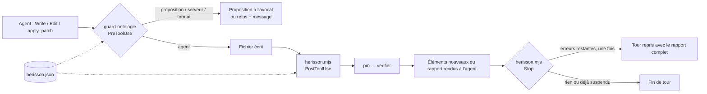

# Le Hérisson : registre et vérification automatique

Le Hérisson est la feature centrale qui garde et vérifie les écritures de l'agent.
Il fait partie du [Harness Legal](harness-legal.md).

Un seul registre décrit les fichiers que l'agent écrit dans `.piecemaker/` :
`server/piecemaker/vendor/piecemaker-plugin/herisson.json`. Deux hooks le
lisent, pour tous les clients (Claude, Codex, Vibe, chat Mistral de l'app) :

- **avant l'écriture** (PreToolUse) : `guard-ontologie.mjs` transforme en
  proposition, ou refuse, l'écriture des features gardées. Le message renvoyé
  à l'agent est le `motif` du registre. Pour une feature à `format`, il
  calcule le fichier tel qu'il serait après l'écriture (Write, Edit,
  MultiEdit, apply_patch) et le contrôle. Une faute nouvelle bloque
  l'écriture : rien n'est écrit, l'agent reçoit les fautes avec leur ligne.
  Une faute déjà présente ne bloque pas, pour laisser l'agent la corriger ;
- **après l'écriture** (PostToolUse) : `herisson.mjs` lance le
  vérificateur `pm` de la feature touchée. Il ne rend à l'agent que les
  éléments du rapport qu'il n'a pas déjà rendus pendant le tour (40 lignes
  au plus). Un rapport inchangé ne rend rien ;
- **après une commande** (PostToolUse sur le shell) : une commande qui
  correspond à la `commande` d'une feature lance aussi son vérificateur. Avec
  `cite`, il est lancé pour chaque programme Catala du dossier dont un fichier
  contient ce texte ;
- **en fin de tour** (Stop) : `herisson.mjs` relance les vérifications
  encore en erreur et suspend la fin de tour une seule fois, avec le rapport
  complet. L'agent corrige, ou cite à l'avocat ce qu'il ne peut pas corriger.

Le Hérisson garde l'état du tour dans un fichier temporaire par dossier
(`<dossier temporaire>/piecemaker-herisson/<empreinte du dossier>.json`) :
pour chaque vérification, son dernier rapport et s'il signale une erreur. La
fin de tour efface ce fichier.

Un élément du rapport est une ligne non indentée avec ses lignes indentées.
Deux éléments sont les mêmes si seuls leur numéro d'ordre et leurs numéros
de ligne diffèrent. Le champ `erreur` du registre dit si une sortie signale
une erreur : les vérificateurs `pm` rendent aussi un texte quand tout est
conforme.

Le raisonnement YAML (`.piecemaker/raisonnements/`) n'est pas une feature du
registre : sa vérification reste lancée par l'agent (`pm raisonnement verifier`).

Les sous-agents gardent leur propre contrôle de fin : `verify-subagent.mjs`
(inchangé).



## Fonctionnement par feature

| Feature | Fichiers (sous `.piecemaker/`) | Écriture | Avant (PreToolUse) | Après (PostToolUse) | Skill | Délai |
|---|---|---|---|---|---|---|
| `ontologie` | `ontologie.json` (dans `~/.piecemaker`), `ontologie.proposition.json` | proposition | devient une proposition (onglet Index › Ontologie) | — | `okf` | — |
| `arborescence` | `arborescence.json`, `arborescence.proposition.json` | proposition | devient une proposition (onglet Index › Classement) | — | `piecemaker` | — |
| `okf` | `okf/**` | serveur | refusée : `pm okf link` / `unlink` | après `pm okf link` ou `unlink` : `pm okf verify` (erreurs, contradictions entre valeurs d'une prémisse, manques) | `okf` | 30 s |
| `etapes` | `etapes.json` | serveur | refusée : l'avocat règle les étapes sur le tableau | — | `piecemaker` | — |
| `protection` | `protection.json` | serveur | refusée : l'avocat lève la protection par le bouclier | — | `piecemaker` | — |
| `suivi` | `<nom>-suivi.json`, `suivi.json` | agent | refusée si le JSON est illisible ou si la racine n'a pas la forme `matter`, `evenements`, `echeances` | `pm suivi_dossiers verifier --suivi <fichier>` | `piecemaker` | 60 s |
| `memoire` | `memoires/<nom>.md` (mémoire projet, règle 4°) | agent | refusée si l'écriture ajoute un frontmatter | `pm memoire verifier --memoire <nom>` : un acte du même nom (voir [suivi-dossier.md](suivi-dossier.md)) | `piecemaker` | 10 s |
| `catala` | `catala/<nom>/*.catala_fr`, `*.toml` | agent | refusée si l'écriture ajoute une faute de format (`.catala_fr` seulement) ou une erreur de compilation | `pm catala verifier --programme <nom>` ; aussi après `pm okf link` ou `unlink` avec `states` ou `involves`, pour chaque programme qui cite une prémisse `okf:/_premises/` | `catala` | 60 s |
| `revue` | aucun fichier : brouillon de revue tabulaire | agent | libre | après `pm tabular_review preparer` ou `lancer` : `pm tabular_review verifier` (recherches en erreur ou à compléter) | `piecemaker` | 30 s |

## Messages renvoyés à l'agent

Texte exact. Entre `<…>` : la partie variable. Un retour à la ligne du message
est noté `⏎`.

| Feature | Moment | Cas | Texte exact |
|---|---|---|---|
| `ontologie` | PreToolUse | Edit, Write ou apply_patch accepté | `Modification enregistrée comme proposition dans ontologie.proposition.json. ontologie.json ne change pas, c’est normal : l’avocat accepte, refuse ou modifie chaque changement dans l’onglet Index › Ontologie.⏎Par rapport à l’ontologie actuelle : relations — <changements> ; types de documents — <changements>.⏎Pour la compléter, modifiez encore ontologie.json : chaque modification s’ajoute à la proposition en attente.` |
| `arborescence` | PreToolUse | Edit, Write ou apply_patch accepté | `Modification enregistrée comme proposition dans arborescence.proposition.json. arborescence.json ne change pas, c’est normal : l’avocat accepte, refuse ou modifie chaque changement dans l’onglet Index › Classement.⏎Par rapport à l’arborescence actuelle : <changements>.⏎Pour la compléter, modifiez encore arborescence.json : chaque modification s’ajoute à la proposition en attente.` |
| `ontologie`, `arborescence` | PreToolUse | proposition partie du fichier actuel (3e ligne remplacée) | `La proposition en attente ne contenait pas le texte remplacé : la nouvelle proposition part du fichier actuel et remplace l’ancienne.` |
| `ontologie`, `arborescence` | PreToolUse | proposition invalide | `Proposition non enregistrée, rien n’a changé : <raison>. Corrigez puis modifiez de nouveau <fichier>.` |
| `ontologie`, `arborescence` | PreToolUse | serveur arrêté (raison) | `PieceMaker n’est pas lancé, la proposition ne peut pas être vérifiée ; demandez à l’avocat de lancer PieceMaker` |
| `ontologie` | PreToolUse | écriture par le shell | `L’ontologie des liens (~/.piecemaker/ontologie.json), commune à tous les dossiers, est réglée par l’avocat seul, dans l’onglet Index › Ontologie. Lisez-la avec pm okf ontologie ; pour proposer un changement, modifiez ontologie.json avec l’outil Edit ou Write (ou apply_patch), jamais par le shell : la modification devient une proposition, l’avocat décide.` |
| `arborescence` | PreToolUse | écriture par le shell | `L’arborescence (.piecemaker/arborescence.json) est réglée par l’avocat seul, dans l’onglet Index › Classement. Pour proposer un changement, modifiez arborescence.json avec l’outil Edit ou Write (ou apply_patch), jamais par le shell, ou lancez pm dossier arborescence --dossiers : la modification devient une proposition, l’avocat décide.` |
| `ontologie` | PreToolUse | accès à la clé de sceau `ontologie.cle` | `La clé de sceau de l’ontologie (~/.piecemaker/ontologie.cle) n’est accessible qu’au serveur PieceMaker.` |
| `ontologie`, `arborescence` | PreToolUse | écriture d'une proposition en attente (`*.proposition.json`) | le texte « écriture par le shell » de la feature |
| `etapes` | PreToolUse | toute écriture | `Les étapes du dossier (.piecemaker/etapes.json) sont réglées par l’avocat seul, sur le tableau de l’onglet Suivi des dossiers. Lisez l’étape en cours et le document à produire avec pm check ; n’écrivez jamais ce fichier. Pour changer une étape, demandez-le à l’avocat.` |
| `protection` | PreToolUse | toute écriture | `La protection des pièces (.piecemaker/protection.json) est écrite par le serveur PieceMaker. Seul l’avocat lève la protection, par le bouclier du dossier dans la barre latérale ; n’écrivez jamais ce fichier. Lisez le Markdown converti d’une pièce protégée au lieu du PDF ou de l’image.` |
| `suivi` | PreToolUse | faute de forme nouvelle | `Écriture refusée par le Hérisson : le fichier de suivi n’a pas la forme attendue. Rien n’a été écrit.⏎<fichier>:<ligne>: <faute>⏎…⏎Corrigez ces lignes puis réécrivez le fichier. Modèle complet : skill piecemaker, references/suivi.md.` |
| `memoire` | PreToolUse | frontmatter ajouté | `Écriture refusée par le Hérisson : la mémoire projet n’a pas la forme attendue. Rien n’a été écrit.⏎<fichier>:1: frontmatter interdit : la mémoire commence par un bloc entre deux lignes « --- ». Retirez ce bloc. Les échéances vont dans .piecemaker/<nom>-suivi.json ; l’étape en cours et le document à produire sont réglés par l’avocat sur le tableau de l’onglet Suivi des dossiers (lisez-les avec pm check).⏎Corrigez puis réécrivez la mémoire : du Markdown simple, sans frontmatter.` |
| `okf` | PreToolUse | toute écriture directe | `Les fiches OKF (.piecemaker/okf/) sont écrites par le serveur. Posez ou retirez un lien avec pm okf link ou pm okf unlink, dans les relations de l’ontologie (pm okf ontologie).` |
| `catala` | PreToolUse | faute de format ou erreur de compilation nouvelle | `Écriture refusée par le Hérisson : le programme ne respecte pas le format Catala ou ne compile pas.⏎<fichier>:<ligne>: <faute>⏎…⏎Corrigez puis réécrivez. Voir le skill catala (references/format.md).` — 10 fautes au plus, puis `… <N> erreur(s) de plus.` Une erreur de compilation s'écrit `<fichier>:<ligne>: compilation : <message du compilateur>` ; `<fichier>` peut être un autre fichier du programme, par exemple le test qui utilise un champ renommé. |
| `revue` | PostToolUse | recherche bloquée (sortie de `pm tabular_review verifier`) | `Recherche « <nom> » : bloquée → pm tabular_review lister (sous-agent deep-research-maker)`, dans le message de vérification ci-dessous |
| toutes les features vérifiées | PostToolUse | le rapport contient des éléments nouveaux et signale une erreur | `Vérification automatique (<feature>) : pm <arguments>⏎<éléments nouveaux>⏎<N> élément(s) du rapport, déjà rendu(s) plus haut et inchangé(s), ne sont pas répétés. Ceux qui signalent une erreur ou un manque restent à corriger.⏎⏎Corrigez chaque erreur ou manque dans le fichier et à la ligne indiqués. Ne relancez pas ce vérificateur : le Hérisson le relance après chaque écriture et rend le rapport complet en fin de tour.` — la ligne `<N> élément(s)…` est absente si rien n'est omis ; 40 lignes au plus, puis `… <N> ligne(s) de plus.` |
| toutes les features vérifiées | PostToolUse | éléments nouveaux, sans erreur | `Vérification automatique (<feature>) : pm <arguments>⏎<éléments nouveaux>⏎<N> élément(s) du rapport, déjà rendu(s) plus haut et inchangé(s), ne sont pas répétés.`, sans consigne |
| toutes les features vérifiées | PostToolUse | sortie vide ou rapport inchangé | aucun message |
| toutes les features vérifiées | Stop | une vérification du tour signale encore une erreur | `Fin de tour suspendue par le Hérisson : <N> vérification(s) signalent encore des erreurs ou des manques dans des fichiers que vous avez écrits pendant ce tour.⏎⏎Vérification automatique (<feature>) : pm <arguments>⏎<rapport complet>⏎⏎Corrigez chaque erreur ou manque dans le fichier et à la ligne indiqués, puis terminez. Si un point ne peut pas être corrigé (pièce absente du dossier, décision qui revient à l’avocat), ne le corrigez pas : citez-le tel quel à l’avocat dans votre réponse finale. La fin de tour ne sera pas suspendue une seconde fois.` |
| toutes les features vérifiées | Stop | plus d'erreur, ou fin de tour déjà suspendue | aucun message |
| `memoire` | PostToolUse | frontmatter déjà présent avant l'écriture (sortie de `pm memoire verifier`, dans le message de vérification ci-dessus) | `.piecemaker/memoires/<nom>.md:1: erreur : pas de frontmatter. Les échéances vont dans .piecemaker/<nom>-suivi.json ; l’étape en cours et le document à produire sont sur le tableau de l’onglet Suivi des dossiers (pm check). Reportez-y ses données, puis retirez le frontmatter.` |
| `memoire` | PostToolUse | aucun acte du même nom (idem) | `.piecemaker/memoires/<nom>.md : manque : aucun raisonnement, programme Catala, suivi ni carte du tableau ne s’appelle <nom>. Nommez la mémoire comme son acte.` |
| `memoire` | PostToolUse | mémoire conforme | aucun message |

Fautes de forme du suivi (`<faute>` ci-dessus), données par `suiviErrors` de
`scripts/lib/herisson.mjs` :

| Faute | Texte exact |
|---|---|
| JSON illisible | `JSON illisible : <message de l'analyseur>. Réécrivez un JSON valide : guillemets doubles, pas de virgule finale, pas de commentaire.` |
| racine non objet | `le suivi est un objet { "matter": {…}, "evenements": { "nom de l’événement": {…} }, "echeances": { "nom de l’échéance": {…} } }, pas une liste.` (ou `pas une valeur seule.`) |
| clé de racine inconnue | `clé « <clé> » inconnue à la racine du suivi. Clés admises : matter, evenements, echeances. Placez son contenu sous l’une d’elles ou retirez-la.` |
| `matter`, `evenements` ou `echeances` non objet | `« <clé> » est un objet { "nom en français": {…} }, pas une liste.` (pour `matter` : `{ "client": …, "summary": … }`) |

Fautes de format Catala (`<faute>` ci-dessus), données par
`catala-documentation.mjs` :

| Faute | Texte exact |
|---|---|
| plusieurs sources dans un titre | `une section = une source : ce titre cite plusieurs identifiants. Écrivez une section ## Article N \| LEGIARTI… par source, avec son extrait et sa règle.` |
| identifiant hors de sa section | `<ID> cité hors de sa section : une règle = une source. Ne citez <ID> que dans son titre ## Article N \| <ID>, jamais dans le texte d'une autre section.` |
| identifiant sans section | `<ID> cité sans section propre : écrivez ## Article N \| <ID> suivi de l'extrait entre « ».` |
| règle sans source | `règle sans source juridique : placez-la sous un titre ## Article N \| LEGIARTI… (JORFARTI) ou ## Décision \| JURITEXT… (CETATEXT, CONSTEXT), suivi de l'extrait exact entre « ».` |
| identifiant mal formé | `identifiant Légifrance mal formé : le préfixe est suivi de 12 chiffres, sans espace.` |
| texte entier cité | `citez l'article (LEGIARTI ou JORFARTI), pas le texte entier (LEGITEXT ou JORFTEXT).` |
| inclusion hors du programme | `inclusion « <chemin> » hors du dossier du programme : placez le fichier dans le programme.` |
| bloc mal ouvert | ``bloc ignoré par Catala : ouvrez-le exactement par ```catala ou ```catala-metadata, sans espace ni majuscule.`` |
| `#[doc]` avec un champ | `#[doc] contient « <champ>: » : le titre va dans ## texte court, la source juridique dans le titre de section.` |
| titre trop court ou trop long | `titre « <titre> » : écrivez 2 à 7 mots, sans identifiant de variable ni « ? ».` |
| étiquette d'article incomplète | `étiquette « <étiquette> » : ajoutez le texte après le numéro (ex. article_2_code_civil).` |
| entrée sans titre | `titre manquant pour cette entrée. Écrivez ## texte court au-dessus.` |
| fait de test sans prémisse | `fait du scénario sans justification : écrivez ## okf:/_premises/<fiche>.md juste au-dessus de <variable>.` |

Le message part dans `permissionDecisionReason` et `systemMessage` en
PreToolUse, dans `additionalContext` en PostToolUse, dans `reason` avec
`decision: "block"` en fin de tour. Le chat Mistral le rend comme erreur de
l'outil (avant), l'ajoute à son résultat (après) ou le reçoit comme message
de reprise (fin de tour).

## Branchements

| Client | Avant | Après | Fin de tour |
|---|---|---|---|
| Claude | `hooks.json` du plugin, matcher `Write\|Edit\|MultiEdit\|NotebookEdit\|Bash\|…` | `hooks.json`, matcher `Write\|Edit\|MultiEdit\|NotebookEdit\|Bash`, 90 s | `hooks.json`, `Stop`, 90 s |
| Codex | `~/.codex/hooks.json`, `^(Bash\|apply_patch)$` | `~/.codex/hooks.json`, `post_tool_use`, `^(Bash\|apply_patch)$`, 90 s, approuvé dans `config.toml` | `~/.codex/hooks.json`, `stop`, 90 s, approuvé dans `config.toml` |
| Vibe | `~/.vibe/hooks.toml`, `piecemaker-guard-ontologie` | `~/.vibe/hooks.toml`, `piecemaker-herisson` (écriture et shell), 90 s | `~/.vibe/hooks.toml`, `piecemaker-herisson-fin-de-tour` (`post_agent`, agent `main`), 90 s |
| Chat Mistral | `guard()` de `mistral-sdk/tools.ts` | `checked()` après Write, Edit et Bash, ajouté au résultat de l'outil | `turnEnd()` de `mistral-sdk/tools.ts`, appelé par `runtime.ts` quand le modèle ne demande plus d'outil, hors mode plan |

## Durée de chaque vérification

Mesures sur un Mac de 8 Go, dossier fictif (6 pièces, un suivi, un programme
Catala).

| Vérificateur | Durée mesurée | Ce qui coûte |
|---|---|---|
| `pm catala verifier` | 21,5 s au premier lancement, 6,0 s ensuite | compilation Catala |
| Garde Catala avant l'écriture (format et `clerk typecheck`) | 1,5 s pour une écriture acceptée, 3,0 à 3,3 s pour une écriture refusée | une compilation par état : après l'écriture, puis avant si elle échoue |
| `pm okf verify` (cœur, 6 pièces) | 44 ms à froid, 14 ms ensuite | — |
| `pm okf verify` (aller-retour `pm` + serveur) | 0,25 à 1,5 s | lancement de `pm` |
| `pm okf verify` (≈ 2 000 documents) | 5,2 s | lecture des fiches |
| `pm suivi_dossiers verifier` (cœur, sans réseau) | 25 ms à froid, 2 ms ensuite | — |
| `pm memoire verifier` (local, sans serveur) | 0,7 ms à froid, 0,2 ms ensuite ; 0,07 à 0,08 s avec le lancement de `pm` | lancement de `pm` |
| Lecture d'une source par le MCP Légifrance (par source vérifiée) | article : 0,55 à 0,70 s en ligne, 0,23 à 0,57 s en cache ; décision : 4,1 s au premier contrôle du jour, 1,1 s en cache | lancement du processus MCP (Node + Python) à chaque source |

Limites des mesures :

- la vérification en ligne des citations du suivi n'est pas mesurée ;
- `pm okf verify` et `pm suivi_dossiers verifier` n'ont pas été mesurés de
  bout en bout sur un dossier enregistré dans l'app ;
- le premier `pm catala verifier` dépasse 20 s : le délai de la feature est
  donc de 60 s, et celui du hook de 90 s ;
- la garde compile en 1,5 s quand le pack est déjà chaud ; une première
  compilation plus longue que 10 s laisse passer l'écriture sans contrôle de
  compilation. Au pire, deux compilations de 10 s restent sous les 30 s de
  `runHook` et des hooks Codex et Vibe.

## Ajouter une feature

1. Ajoutez une entrée dans `herisson.json` : `nom`, `cible` (expression
   régulière sur le chemin relatif à `.piecemaker/`, groupe `nom` facultatif),
   `ecriture`, `skill`, et `motif` (feature gardée) ou `verifier` et `delai`
   (feature écrite par l'agent). `{nom}` dans `verifier` reçoit le groupe `nom`.
   Facultatif :
   - `erreur` : expression régulière sur la sortie de `verifier`. Elle dit
     si la sortie signale une erreur ou un manque. Sans `erreur`, toute
     sortie non vide est une erreur. Seule une sortie en erreur reçoit la
     consigne de corriger et suspend la fin de tour ;
   - `format` : contrôle du fichier entier avant l'écriture, nommé dans
     `FORMATS` de `scripts/lib/herisson.mjs`, avec ses deux phrases de refus
     dans `REFUSALS`. `suivi` contrôle le JSON et les clés de la racine,
     `memoire` refuse un frontmatter. `catala` applique aux `.catala_fr` le contrôle de format de `pm catala verifier`
     (`catala-documentation.mjs`), puis, si le dossier du programme contient
     `clerk.toml`, `clerk typecheck` sur une copie du programme où le fichier
     porte le texte écrit (`typecheckErrors` de `catala.mjs`, 10 s au plus).
     Seules les erreurs absentes de l'état actuel sont refusées, comparées par
     message, sans ligne ni chemin. Un module manquant
     (`Required module not found`) est ignoré : un programme en plusieurs
     fichiers s'écrit fichier par fichier. Sans pack, après 10 s ou si le
     compilateur plante sans ligne `[ERROR]`, l'écriture passe ;
   - `commande` : expression régulière sur une commande shell, qui lance
     `verifier` dans le dossier courant ;
   - `cite` : avec `commande`, lance `verifier` pour chaque programme
     `catala/<nom>/` dont un fichier `.catala_fr` contient ce texte.
2. Ajoutez un cas dans `scripts/herisson.test.js`.
3. Ajoutez ses messages au tableau « Messages renvoyés à l'agent ».

Aucun hook n'est à modifier.

Limites :

- avant l'écriture, `suivi` ne contrôle que la racine du fichier : les clés
  d'un événement ou d'une échéance sont contrôlées après l'écriture par
  `pm suivi_dossiers verifier`, qui en tient la liste ;
- la fin de tour lit l'état du dossier courant de l'agent : une écriture dans
  un autre dossier que le dossier courant n'est pas reprise en fin de tour ;
- la fin de tour n'est suspendue qu'une fois. Si l'utilisateur interrompt le
  tour repris, la fin du tour suivant passe sans suspension ;
- un sous-agent écrit dans le même état que l'agent principal : ses erreurs
  restantes sont rendues à la fin du tour de l'agent principal ;

- une écriture de fichier par le shell (`cat >`, `sed -i`) n'est ni filtrée ni
  vérifiée ;
- une `commande` est vérifiée dans le dossier courant de l'agent, pas dans un
  `--dossier` passé à `pm` ;
- `format` ne contrôle pas une modification qu'il ne sait pas appliquer
  (texte à remplacer introuvable, `search_replace` de Vibe) : `verifier` la
  signale après l'écriture ;
- la compilation avant l'écriture ne voit que les erreurs de typage
  (`clerk typecheck`), pas les tests ni les preuves ; une erreur déjà
  présente avec le même message, ailleurs dans le programme, laisse passer
  la nouvelle ; un processus enfant du compilateur peut survivre au délai de
  10 s.
