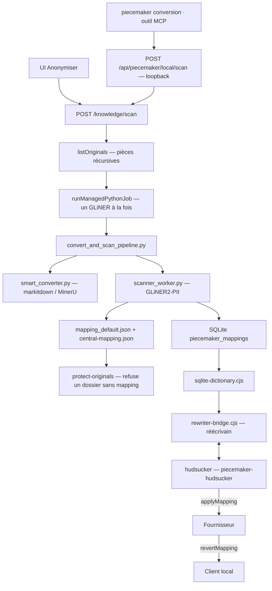

# Anonymisation PieceMaker — chemin retenu

Un seul enchaînement construit le mapping et un seul point de passage code
les messages. Le modèle ne voit que des codes ; le cabinet ne voit que des
noms. Les fichiers restent en clair sur le disque.

Depuis la consolidation, `POST /knowledge/scan` est la **seule** porte de la
conversion : l'UI, le CLI `piecemaker conversion` et l'outil MCP `conversion`
y aboutissent tous. Il n'existe plus de conversion Markdown sans scan.

---

## Vue d’ensemble

---

## 1. Lancement

Surfaces : `AnonymizationLauncher`, `CaseMappingSetup`, `CaseFilesChronology`,
plugin dossier. Toutes posent `POST /api/piecemaker/knowledge/scan`
(`createKnowledgeRouter`, `createKnowledgeService.scan`).

Le service démarre un job (`createKnowledgeScanJobs`) puis appelle
`createKnowledgePipeline.scan`. Un scan déjà en cours sur le même projet est
réutilisé. Deux dossiers distincts partagent le verrou GLiNER de
`runManagedPythonJob` : le second attend.

Sans liste de fichiers, `defaultScanFiles` réutilise `listOriginals` : arborescence
complète, hors Markdown généré, hors ressources. `--skip-existing` évite de
recharger GLiNER sur un dossier déjà scanné. Une liste explicite force le
retraitement de ces pièces.

## 2. Markitdown / GLiNER

`runManagedPythonJob` lance `convert_and_scan_pipeline.py` (exclusivité GLiNER,
budget RAM, nice, timeout).

- Phase CONVERT : `smart_converter.py` (`auto` → markitdown si couche texte,
  MinerU sinon).
- MinerU absent : avant tout traitement (GLiNER non chargé), le pipeline
  repère les pièces à convertir sans couche texte (PDF scannés, images).
  Lancé avec `--ocr-missing ask` (fenêtre d'anonymisation, onglet Dossier), il
  s'arrête en code 3 et émet `OCR_REQUIRED:{"files":[…]}` ; le travail passe
  à l'état `ocr-required` et l'interface ouvre `OcrDecisionDialog` : installer
  MinerU (`POST /configuration/install`, étape 04 avec
  `PIECEMAKER_INSTALL_MINERU=1`, puis relance en `ask`) ou continuer sans OCR
  (relance en `continue`). En `continue` (défaut, CLI compris), ces pièces
  passent par markitdown et leur entrée `converted` porte `"ocr": "missing"` ;
  dès que MinerU est disponible, elles sont reconverties puis réanalysées au
  lancement suivant. MinerU est détecté par ses paquets (`mineru`,
  `mineru_llama_cpp`) dans le venv qui exécute le pipeline.
- MinerU 4 (`mineru_improved_1.py`) : niveau `standard`, un seul modèle de
  lecture, MinerU2.5-Pro (GGUF via llama.cpp), avec ses petits modules ONNX de
  mise en page et d'OCR. Le PDF est découpé en PDF d'une page, et chaque page
  est convertie dans son propre sous-processus, avec un moteur bridé :
  1 requête à la fois, contexte de 8192, 4 threads, CPU seul, fenêtre d'une
  page. Le superviseur mesure l'empreinte mémoire réelle du sous-processus
  (`phys_footprint` sous macOS, qui compte aussi la mémoire compressée ;
  la RSS ailleurs). Il le tue au-delà de 35 % de la RAM totale
  (`PIECEMAKER_MINERU_RAM_BYTES`) ou si la mémoire libre du poste passe sous
  5 % (`PIECEMAKER_MINERU_FREE_FLOOR_BYTES`). Le sous-processus d'une page
  s'arrête de lui-même si son superviseur disparaît. Mesure sur une page
  scannée fictive, Mac de 8 Go : pic de 2,0 Go, environ 60 s par page.
- Phase SCAN : `scanner_worker.py` charge GLiNER2-PII (`fastino/gliner2-privacy-filter-PII-multi`, commit `59894c087cb2923b01f337d4ee72f6ff84d5bdd6`) **une fois** depuis le dossier snapshot du cache Hub,
  puis scanne chaque Markdown (protocole JSON-line). Les cartes brutes
  (`*_sensitive_map.json`) restent dans un répertoire temporaire et sont
  détruites après fusion.

État technique : `.piecemaker/anonymization-state.json` et
`.piecemaker/document-index.json` du dossier, pas un temp jeté. Ce dernier ne
sert plus qu'à transmettre le résultat du scan Python au serveur (et à porter
les anciens `overrides` en attente d'import en base) ; les corrections vivent
dans SQLite (voir `outil-sql.md`).

## 3. SQLite et mapping disque

Après un scan réussi, le pipeline fait les deux écritures :

| Cible | Module | Consommateur |
| --- | --- | --- |
| `piecemaker_mappings` / `piecemaker_nodes` | `persistScanResult` | proxy PII (`createSqliteDictionaryLoader`) |
| `Fichiers convertis PieceMaker/mapping_default.json` | `writeCaseMapping` | `protect-originals` (`caseHasMapping`), Cursor |
| `~/.piecemaker/central-mapping.json` | `syncCentralMapping` | garde Cursor, rechargement historique |

Sans le JSON, le hook PreToolUse traiterait le dossier comme non anonymisé.
Sans SQLite, le proxy relayerait en clair.

## 4. Proxy PII

La substitution n’a jamais lieu dans un hook. `protect-originals.mjs` refuse
les originaux protégés et un dossier sans `mapping_default.json`.

Démarré avec le serveur (`createAnonymizerService`, `startRequiredAnonymizer`).
Deux pièces, un seul cycle de vie :

- `hudsucker-proxy/` (Rust) : proxy HTTPS d’interception avec l’autorité locale
  `~/.piecemaker/certs/`. N’intercepte que `api.anthropic.com`,
  `api.openai.com`, `chatgpt.com` (et l’hôte de `ANTHROPIC_BASE_URL` s’il est
  distant) ; tout le reste passe en tunnel `CONNECT` sans être lu.
- `rewriter-bridge.cjs` : réécrivain local, dans le processus serveur, que
  hudsucker appelle pour chaque corps JSON, flux SSE et trame WebSocket.

Cycle de vie :

- hudsucker écoute un port choisi par le système (`127.0.0.1:0`) et n’annonce
  `listening` qu’une fois le port ouvert. L’app de bureau et le serveur de dev
  ont chacun leur proxy, sans conflit.
- hudsucker lit son stdin : quand le serveur meurt, même tué net, le tube se
  ferme et hudsucker s’arrête. Il ne peut pas survivre à PieceMaker.
- `GET /health` sur le port du proxy vérifie aussi le réécrivain (200 / 503).

Routage : uniquement par l’environnement du processus serveur
(`HTTPS_PROXY`, `NODE_EXTRA_CA_CERTS`, `CODEX_CA_CERTIFICATE`,
`SSL_CERT_FILE`…), hérité par le chat et les terminaux intégrés. Aucun fichier
de configuration client n’est écrit : une session ouverte hors de PieceMaker
part en direct ; une session ouverte par PieceMaker ne peut pas contourner le
proxy, et échoue s’il est arrêté. Au démarrage, `removeLegacyProxyConfig`
retire les traces des versions précédentes (`HTTPS_PROXY` dans
`~/.claude/settings.json`, hooks `proxy-guard.mjs`, `mikePiiPort`).

Échec fermé : un corps vers un hôte intercepté est décompressé
(gzip, br, zstd, deflate) avant réécriture ; un encodage inconnu, un corps non
JSON ou un réécrivain injoignable sont refusés et journalisés
(`[piecemaker] hudsucker : refus …`), jamais relayés en clair. Une trame
WebSocket non anonymisable ferme la connexion (1011).

Le réglage `anonymizer.enabled: false` dans `~/.piecemaker/config.json`
désactive le démarrage du proxy et laisse les échanges avec les fournisseurs
partir directement. La commande
`node scripts/piecemaker/cli/disable-anonymizer.mjs` applique ce réglage.
La protection des pièces reste indépendante de ce choix.

- Sortant : `anonymize` → `applyMapping` (`substitution.cjs`, plus longue
  entité d’abord, frontières Unicode).
- Entrant : `deanonymize` → `revertMapping`, y compris SSE fragmenté
  (`rewrite.cjs`, `createSseRewriter`).
- Dictionnaire : SQLite, rechargé sur `data_version`. Mapping vide = relais
  transparent.

Cursor n’est pas interceptable : un shim `~/.piecemaker/bin/cursor-agent`,
placé en tête du `PATH` du serveur seulement, le bloque tant qu’un mapping
existe.

### Dossier de la session

Le serveur lance chaque session de fournisseur (`runtime.run` : Claude, Codex,
Vibe, opencode) avec `HTTPS_PROXY=http://<project_id>:<jeton>@127.0.0.1:<port>`
(`session-runtime.ts`). Le dossier est le plus profond dont le chemin contient
le répertoire de la session ; le jeton est tiré au démarrage du service et ne
vaut que pour lui. Rien n'est écrit dans un fichier CloudCLI : `process.env`
est enveloppé pendant que le proxy tourne, et seules `HTTPS_PROXY` /
`https_proxy` y prennent, dans le contexte asynchrone d'une session
(`AsyncLocalStorage`), la valeur porteuse du dossier.

Claude CLI, Codex (HTTPS et WebSocket) et Vibe envoient ces identifiants dans
l'en-tête `Proxy-Authorization` du `CONNECT` (vérifié avec un proxy de capture
local et des clés factices). hudsucker les mémorise par adresse cliente du
tunnel, les transmet au réécrivain (`x-piecemaker-proxy-authorization`, sur
`/v1/request`, `/v1/response`, `/v1/sse`, `/v1/ws`) et ne les relaie jamais
au fournisseur. Le réécrivain n'accepte que son propre jeton.

Le dossier ne cloisonne rien : tous les noms de tous les dossiers restent
masqués. Il ne sert qu'à deux choix :

- **Variante partagée** (« Exemplon » pour Paul et Anne Exemplon, dans un même
  dossier ou dans deux) : pour toute la requête, le code retenu est celui du
  nœud du dossier de la session ; sinon celui du dossier dont les autres noms
  et codes non ambigus sont les plus présents dans la requête ; puis celui de
  la personne dont le code y figure déjà ; puis l'ordre du dictionnaire
  (`resolveContext`, `dictionary.cjs`). Les codes étant uniques dans la base,
  la réponse se ré-identifie d'elle-même vers la personne choisie.
- **Ancien code cédé** : dans une session du dossier renuméroté, l'ancien code
  (`codes_retires`) revient vers sa propre personne ; ailleurs, vers le dossier
  qui l'a gardé.

Une session sans dossier connu (terminal intégré, session ouverte hors de
PieceMaker, répertoire hors de tout dossier) n'applique que la règle du
contexte.
---

## Performance du scan

Inférence officielle GLiNER2 : **PyTorch**. CUDA s’il y a un GPU NVIDIA, sinon
CPU. Pas de CoreML (API Apple, hors doc Fastino).

Le temps est dans l’encodeur, pas dans le glue Python. `--skip-existing` évite
de recharger GLiNER sur un dossier déjà scanné. `classify_text` par occurrence
a été retiré ; il reste un appel sur l’en-tête (nature / date).

Réglages Fastino : seuil 0,5, chunks de 384 mots (recouvrement 64), batch 8, descriptions
courtes pour six labels (`person`, `company`, `organization`, `address`, `city`, `country`).
`progress_extraction.py` rejoue la boucle de `extract_entities_long` par tranches pour
épingler la progression ; un test garantit un résultat identique. La détection reste large :
les institutions à ne pas anonymiser sont écartées en aval, à la construction du mapping, par
`institutional-terms.cjs`.

La liste (globale, éditable depuis le mapping du dossier, « Termes institutionnels ») vit dans la
table `piecemaker_institutional_terms` de `auth.db`, que la désinstallation conserve
(`server/piecemaker/institutional-terms.ts`). À la création de la table, elle reprend
`~/.piecemaker/institutional-terms.json` s’il existe. À chaque démarrage, les termes de
`institutional-terms.default.json` (livré à côté du module) jamais encore proposés à cette base
y sont ajoutés, puis notés dans `piecemaker_institutional_terms_offered_defaults` : les ajouts
de l’utilisateur sont conservés, un terme par défaut qu’il a retiré ne revient pas, et une liste
vidée reste vide. Lors de la mise à jour qui crée cette table, tous les termes par défaut sont
proposés une fois. Le fichier JSON n’est plus qu’une
copie, réécrite depuis la base à chaque démarrage et à chaque enregistrement : c’est elle que
lisent `institutional-terms.cjs` et le plugin Dossier, sans dépendance SQLite. Une modification
faite à la main dans ce fichier est donc perdue.

---

## Codes globaux

Un code (`PERSONNE_PHYSIQUE_N`, `SAS_N`, `CLIENT_…_N`…) n'appartient qu'à un
seul nœud de toute la base. Les codes réservés sont, pour tous les dossiers :
`piecemaker_mappings.masked_value`, les identifiants `entity:CODE`,
`data_json.code` et `data_json.codes_retires`.

- **Attribution** : le numéro suivant le plus grand déjà attribué pour ce
  préfixe (`codeRegistry`, `party-codes.ts` ; `load_reserved_codes` et
  `merge_with_existing_mapping` côté Python). Aucune largeur maximale :
  `padStart(2)` / `:02d` ne sont qu'un minimum, `_99` est suivi de `_100`,
  `_999999` de `_1000000`. Un numéro libéré n'est jamais réutilisé. Coût
  constant par attribution une fois les codes chargés.
- **Garde** : le magasin refuse d'écrire un code tenu par un autre dossier, ou
  retiré par un autre dossier, sauf pour le dossier qui le tient déjà.
- **Frontières** : rien ne borne la longueur d'un code. Les motifs sont tous
  `_\d+` ; la ré-identification exige une frontière Unicode de part et
  d'autre, donc `PERSONNE_PHYSIQUE_1` ne prend jamais dans
  `PERSONNE_PHYSIQUE_12345` ; le SSE retient jusqu'à 128 caractères de mot
  (`MAX_HELD_WORD`), loin au-dessus d'un code ; le proxy Rust ne lit aucun
  code ; l'interface surligne des noms, pas des codes. Le masquage des codes
  déjà présents dans un texte utilise des jetons délimités de la zone privée
  Unicode, numérotés sur les seuls codes présents (auparavant un caractère par
  rang dans tout le dictionnaire, qui sortait de la zone privée au-delà de
  6 400 codes).

### Migration des collisions

À l'ouverture du magasin (`KnowledgeStore`, donc au démarrage du serveur), les
codes tenus par plusieurs dossiers sont renumérotés. Le premier dossier à
l'avoir tenu (plus ancien `created_at`, vivant ou retiré) le garde ; chaque
autre dossier qui le tient vivant reçoit le numéro suivant de ce préfixe.
L'ancien code passe dans `codes_retires` du nœud renuméroté.

- Sauvegarde préalable, seulement s'il y a une collision :
  `backups/auth-avant-codes-globaux-<horodatage>.db` à côté de `auth.db`
  (`VACUUM INTO`).
- Une seule transaction ; une base sans collision n'est pas touchée : relancer
  ne fait rien.

Ce qui est migré : `piecemaker_mappings`, l'identifiant du nœud
(`entity:CODE`) avec ses liens et citations, `data_json.code`, et toute valeur
de `data_json` égale à l'ancien code dans le dossier renuméroté (références du
registre public : dirigeants, SIREN, adresse ; `originalCode`).

Ce qui ne l'est pas :

- `.piecemaker/document-index.json` (`personnes_visees`) du dossier
  renuméroté garde l'ancien code. Sans effet : le scan suivant l'ignore, les
  liens déjà en base ont été renommés, une pièce rescannée reçoit le nouveau.
- Les anciens fichiers `mapping*.json` d'un dossier (plus jamais écrits, lus
  seulement) gardent l'ancien code.
- Ce que le fournisseur garde d'une conversation (`previous_response_id`,
  raisonnement chiffré `encrypted_content`) : le modèle peut réemployer
  l'ancien code. Dans une session du dossier, il revient vers la bonne
  personne ; lu depuis une session d'un autre dossier, il revient vers le
  dossier qui l'a gardé.
- Les transcriptions, pièces converties et l'historique Git des dossiers sont
  en clair : ils ne contiennent pas de codes.

## Invariants

- Un seul worker GLiNER à la fois, tous dossiers confondus.
- Substitution triée de l’entité la plus longue à la plus courte.
- Un code ne désigne qu’une personne dans toute la base, tous dossiers
  confondus (voir « Codes globaux »).
- Un code fusionné dans un autre (`codes_retires` du survivant) reste réservé
  dans tous les dossiers et se ré-identifie toujours vers le survivant. Un
  scan sans pièce nouvelle fusionne aussi les doublons déjà en base.
- Les originaux ne quittent pas le dossier ; seuls Markdown + codes partent
  vers le modèle.
- Le harnais de citations observe le clair **avant** anonymisation et **après**
  ré-identification (`docs/harness-legal.md`).
