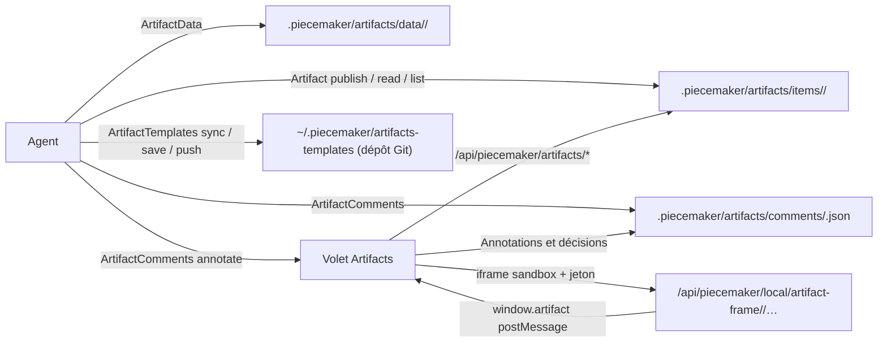

# Artifacts (MCP `artifacts` et onglet Artifacts)

Reprise, dans PieceMaker, de la fonction Artifacts de Claude : l'agent publie des pages HTML pour le dossier, l'avocat les voit dans l'onglet **Artifacts**, en garde les versions, les commente et les annote. Les quatre outils reprennent les paramètres de ceux de Claude ; un lien s'écrit `piecemaker://artifact/<id>`, un template `piecemaker://template/<nom>`.



## Outils

| Outil | Actions | Rôle |
|---|---|---|
| `Artifact` | `publish` (défaut), `read`, `list`, `delete`, `open`, `pin`, `unpin`, `quickstart` | pages, versions, fichiers annexes, assets, templates |
| `ArtifactData` | `get`, `list`, `query`, `set`, `update`, `str_replace`, `delete`, `batch` | base partagée d'un artifact, même moteur que `FeatureData` (`store.mjs`) |
| `ArtifactComments` | `read`, `reply`, `resolve`, `annotate` | ouverture de la revue, annotations et décisions de l’avocat |
| `ArtifactTemplates` | `list`, `read`, `run`, `status`, `sync`, `save`, `push` | bibliothèque de templates, dépôt séparé, scripts Python des templates |

Repris d'Artifact : `file_path`, `url`, `title` (repli quand la page n'a pas de `<title>`), `description`, `icon`, `label`, `edits` (tout ou rien, puis écrits sur disque), `files` (carte chemin publié → source, `null` retire, les absents restent), `type_url`, `capabilities`, `pin`, `force`, `asset` / `file_paths`, `path`, `ver`, `scope` (`mine`, `pinned`, `types`, `files`, `versions`, `assets`), `limit`, `type`, `intent` (`document`, `slides`, `design`, `other`).

Règles reprises :

- Un publish vers un artifact que la session n'a ni lu ni publié est refusé ; le refus marque la version en ligne comme lue et la renvoie. Si elle a changé depuis la lecture, refus de même ; `force` l'écrase.
- Limites : page 16 Mo, fichier texte 16 Mo, binaire 15 Mo, 255 fichiers par publish, 511 fichiers et 256 Mo par version, 64 edits. `preflight.js` est réservé ; une page annexe commence par `<!doctype html>`.
- Un publish réussi ouvre l'onglet sur l'artifact (`useAutoPanel` lit le lien dans le résultat) : pas d'`open` nécessaire. `open` passe par `pm tab afficher artifacts <id>`.
- Les sources sont dans le dossier (ou le dossier temporaire de la machine).

Non repris : partage entre utilisateurs (un dossier n'a qu'un avocat), `contract`, `overwrite_unread`, `from_url`/`asset_ids` (copie entre artifacts), `root`, comptes et rôles « writer ».

## Stockage

```
.piecemaker/artifacts/items/<id>/artifact.json      {id, title, description, icon, type, pinned, capabilities, versions[], assets[]}
.piecemaker/artifacts/items/<id>/v/<n>/<chemin>     fichiers publiés de la version n (index.html = la page)
.piecemaker/artifacts/items/<id>/assets/<hex>.<ext> assets téléversés
.piecemaker/artifacts/data/<id>/<collection>/<doc>.json
.piecemaker/artifacts/comments/<id>.json
```

Une version est écrite dans un dossier temporaire puis renommée : jamais de version à moitié écrite. Le Hérisson (entrée `artifacts` de `herisson.json`) refuse Edit, Write et le shell sous `.piecemaker/artifacts/`.

## Affichage

- Le manifeste `plugins/piecemaker-artifacts` déclare le volet. Le volet natif (`src/modules/piecemaker-artifacts`) demande un jeton d'affichage (`POST /api/piecemaker/artifacts/:id/frame`, authentifié), valable une heure, puis charge `/api/piecemaker/local/artifact-frame/<jeton>/index.html` dans une iframe `sandbox="allow-scripts allow-forms allow-popups allow-modals allow-downloads"`, sans `allow-same-origin` : la page n'a ni le jeton de session ni le stockage de PieceMaker.
- CSP de la page : `connect-src 'none'` (aucune requête réseau), images et médias de l'application ou `data:`/`blob:`, scripts des CDN admis par Claude (cdnjs, jsdelivr, unpkg, tailwind, jquery), styles Google Fonts.
- Le serveur injecte `__piecemaker/runtime.js` en tête de la page : `window.artifact.db` (capability `db`), `window.artifact.theme`, `window.artifact.download`, événements `artifact:data` et `artifact:theme`. Les appels passent par `postMessage` vers l'onglet, qui vérifie la source et appelle `POST /api/piecemaker/artifacts/:id/data`, refusé sans la capability.
- L'onglet interroge l'artifact affiché toutes les 3 s : nouvelle version → rechargement (si l'avocat regarde la dernière), base modifiée → `artifact:data`.
- Galerie : tous / épinglés, épingler, supprimer (deux clics), copier le lien, changer de version et ouvrir la revue.

## Revue dans PieceMaker

- Le bouton **Revue** ouvre les commentaires de la version affichée. L’avocat peut surligner un passage, y ajouter une remarque ou commenter la version entière.
- L’avocat peut approuver la version ou demander des modifications. Une demande contient un motif. Chaque décision est liée à la version affichée.
- PieceMaker enregistre les fils et les décisions dans `.piecemaker/artifacts/comments/<id>.json`. Les annotations incluent le texte sélectionné, sa position et son contexte immédiat.
- `ArtifactComments annotate url=… ver=…` ouvre la revue à cette version via la commande de volet existante. Sans `ver`, l’outil choisit la dernière version.
- `ArtifactComments read` renvoie les fils. Les décisions portent la valeur `approved` ou `changes_requested` dans `anchor.decision`. L’assistant peut répondre, puis résoudre chaque fil traité.
- PieceMaker récupère les anciennes décisions terminées lors de la lecture des fils. Les fils déjà importés restent consultables.

## Templates

- Embarqués : `vendor/mcp/artifacts/templates/` (`page`, `document`, `slides`, `tracker`, `chronologie`).
- Dépôt de la bibliothèque : `PieceMaker-Legal/PieceMaker_Electron`, vidé le 18/11/2026 pour cet usage (l'ancien historique est conservé en bundle git dans les fichiers du projet). Autre dépôt : `ArtifactTemplates sync repository=<url>`, ou `PIECEMAKER_ARTIFACT_TEMPLATES_REPO`. Réglage dans `~/.piecemaker/artifacts-templates.json`.
- Un template : `<nom>/template.json` (`title`, `description`, `intent`, `icon`, `entry`, `read_first`, `references`, `scripts`, `capabilities`, `data_files`), `index.html`, `README.md`, fichiers annexes copiés dans l'artifact. À nom égal, le dépôt l'emporte sur l'embarqué.
- `references` (pages lues à la demande) et `scripts` (`[{name, file, description, args}]`, fichiers `.py`) ne sont jamais copiés dans l'artifact, pas plus que `scripts/`, `references/` et `__pycache__/`.
- `ArtifactTemplates run type_url=… script=… args=[…] [url=…]` lance le script avec l'interpréteur Python de PieceMaker (`python.mjs`, même résolution que `pythonExecutable` du pipeline : environnement commun de `config.json`, `PYTHON_PATH`, `~/.piecemaker/venv`), dossier courant = le dossier, délai 10 min. Variables : `PIECEMAKER_CASE`, `PIECEMAKER_TEMPLATE_DIR`, `PIECEMAKER_ARTIFACT_OUT` (`Artifacts/<template>/`, créé), `PIECEMAKER_ARTIFACT_URL`. Un code de sortie non nul est une erreur de l'outil. Les scripts viennent du dépôt de l'avocat : ils ont les droits de PieceMaker sur la machine.
- La page ne lit pas un fichier publié par `fetch` (`connect-src 'none'`) : un script écrit `data.js` (`window.X = …;`), chargé par `<script src>`.
- `sync` clone ou avance en `--ff-only` ; `save` copie un artifact dans le clone et commite ; `push` n'est lancé qu'à la demande de l'avocat.

## Skill

`vendor/piecemaker-plugin/skills/creation-artifacts/` (déclaré par `skill-declaration.ts`) : quand faire un artifact, déroulé quickstart → template ou page → publish, modifications, données, commentaires, templates, interdits ; `references/contrat-page.md` (contrat de page : titre, jetons, thèmes, largeur téléphone, isolement) et `references/runtime.md` (`window.artifact`). La liste des skills des instructions d'agent y renvoie (« Page à regarder ou à utiliser »).

## Tests

`node --test server/piecemaker/vendor/mcp/artifacts/server.test.js`, `server/piecemaker/artifacts.test.ts` (routes, jeton, CSP, capability), `autoPanelRules.test.ts` (ouverture après publish).
