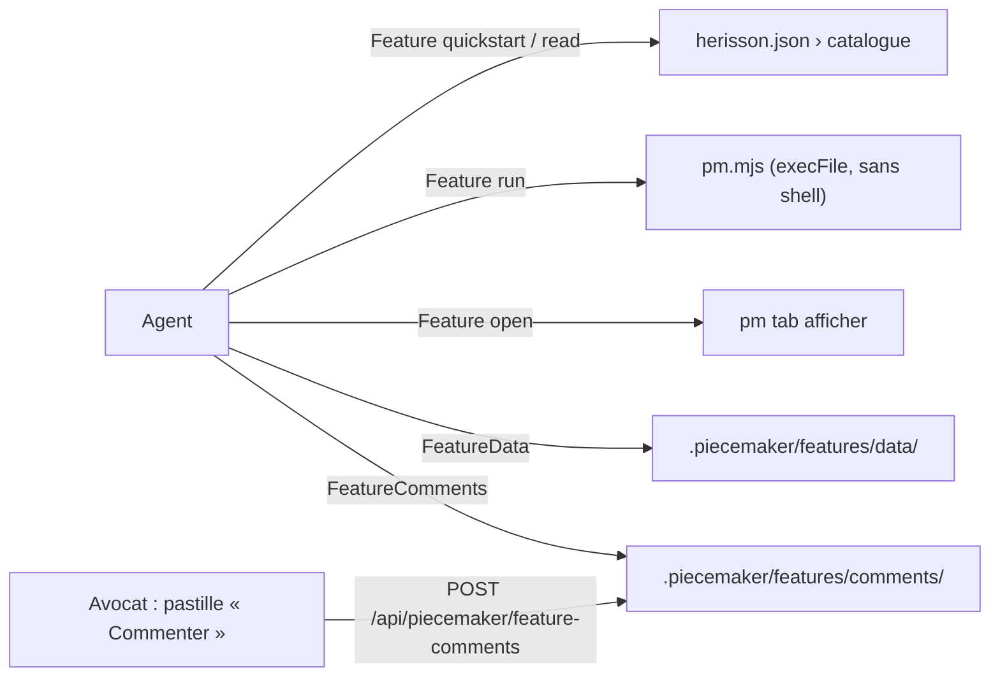

# Features (MCP `features`)

Le MCP `features` donne à l'agent les fonctions de PieceMaker par trois outils. Une **feature** est un onglet du dossier avec ses skills et ses commandes `pm`. L'agent ne lit le skill que de la feature qu'il utilise : la découverte est progressive.



## Outils

| Outil | Actions | Rôle |
|---|---|---|
| `Feature` | `quickstart`, `list`, `read`, `run`, `open` | catalogue, skills, commandes `pm`, onglets |
| `FeatureData` | `get`, `list`, `query`, `set`, `update`, `str_replace`, `delete`, `batch` | base de données par feature, mêmes paramètres qu'`ArtifactData` |
| `FeatureComments` | `read`, `reply`, `resolve` | fils de commentaires de l'avocat, mêmes paramètres qu'`ArtifactComments` |
| `OkfWrite` | `link`, `unlink`, `mark_examined` | liens cités de l'index OKF, une ou plusieurs opérations par appel (`writes`, 50 au plus, toutes validées avant la première, arrêt au premier échec) ; le schéma impose les relations de l'ontologie (`~/.piecemaker/ontologie.json`, lue au démarrage du MCP) |

`FeatureData` et `FeatureComments` reprennent les paramètres des outils `ArtifactData` et `ArtifactComments` de Claude. `feature` remplace `url`. Non repris : `profiles`, `as_level`, `file_path`, `out_dir`, `cursor` de `read`, `watch`.

- `quickstart` est le premier appel d'un travail nouveau. Il prend `intent` (`case`, `index`, `review`, `stamp`, `reasoning`, `deadlines`, `catala`, `draft`, `other`) et renvoie la feature, ses commandes, la référence à lire avant chaque tâche, un extrait de `pm check` et les premiers appels.
- `read` sans `path` renvoie la même fiche. Une ligne par référence : `Before you …: Feature read <feature> path=<skill>/references/<fichier>`. Le texte vient du champ `quand` de la référence dans le catalogue. Un skill sans références (catala, docx-cli, style-redaction-cabinet) donne `path=<skill>/SKILL.md`. `read` avec `path` renvoie le fichier.
- `run` prend `name`, `command` et `args`. Le catalogue traduit les noms anglais en argv `pm`. `pm` garde ses noms français.
- `read projects` liste aussi les fichiers du dossier, Word en tête, hors fichiers cachés et `.piecemaker/`.

## Catalogue

Le catalogue est la clé `catalogue` de `server/piecemaker/vendor/piecemaker-plugin/herisson.json`. Chaque entrée porte `nom`, `titre`, `description`, `volet`, `skills`, `demarrage` et `commandes`. Un skill est `{chemin, references}` ; une référence est `{fichier, quand}`.

Une commande est `{nom, pm, role, parametres}`. Valeurs d'un paramètre :

| Valeur | Sens |
|---|---|
| `"#"` | positionnel requis |
| `"#?"` | positionnel facultatif |
| `"--option"` | option `pm` ; `true` donne l'option seule, un objet est passé en JSON |

`parametres` au niveau de la feature sert de défaut à ses commandes. `pm catala exec` n'est pas exposé.

## Données

```
.piecemaker/features/data/<feature>/<collection>/<doc>.json   {data, version, updatedAt}
.piecemaker/features/comments/<feature>.json                  {threads: [{id, anchor, messages, resolved}]}
```

- Adresse : `collection` (1 à 15 segments, nombre impair) et `doc_id`. Segment : `A-Z a-z 0-9 _ - . ~ : @ +`, 200 caractères au plus.
- `if_version` (version lue, à partir de 1) est requis sur toute écriture d'un document existant.
- `update` fusionne les objets ; `{"__delete__": true}` retire un champ, refusé par `set` et dans un tableau.
- `str_replace` agit sur un champ de premier niveau ; `old_str` unique, sauf `replace_all`.
- `query` : `limit`, `cursor`, `where` (10 clauses au plus), `order_by` (une seule page, sans `next_cursor`).
- `batch` : `writes`, 50 écritures `set`, `update` ou `delete` au plus, tout ou rien.
- Écritures atomiques et verrouillées.
- La feature `case` lit en plus les collections `okf`, `deadlines` et `memories`, en lecture seule. Un nom de fichier hors de l'alphabet des segments devient un `doc_id` en base64url.
- Le Hérisson (entrée `features`) refuse Edit, Write et le shell sur `.piecemaker/features/`.

## Commentaires ancrés

1. L'avocat cible un élément d'un volet ; une pastille apparaît au-dessus du chat.
2. Il clique 💬 « Commenter » sur la pastille.
3. À l'envoi, le client crée l'identifiant du fil, l'ajoute à la ligne de la pastille (`commentaire : FeatureComments read feature=<feature> thread_id=<id>`) et poste le fil.
4. La route `POST /api/piecemaker/feature-comments?projectId=…` écrit le fil (`server/piecemaker/feature-comments.ts`).
5. L'agent lit le fil par `FeatureComments read`, répond par `reply`, le marque résolu par `resolve`. Une réponse ne rouvre pas un fil résolu.

Feature du fil : `catala` pour le volet Catala, `case` sinon.

## Hérisson

Le hook PostToolUse traite `mcp__features__Feature` avec `action: run`, et `mcp__features__OkfWrite`, comme la commande `pm …` équivalente. Les matchers Claude (`hooks/hooks.json`) et Codex (`codex-skills.mjs`) incluent l'outil MCP.

## Déclaration

`BUNDLED_SERVERS` de `server/piecemaker/mcp-declaration.ts` déclare `features` dans chaque dossier, comme `legifrance` (`.mcp.json`, `.codex/config.toml`, `.vibe/config.toml`). Le serveur MCP prend le dossier courant comme racine.

## Limites connues

- Le hook Vibe (`vibe-hook.mjs`) ne couvre pas les outils MCP.
- `guard-ontologie` ne voit pas `Feature run` : `pm` garde ses propres contrôles.
- À vérifier en essai réel : dossier courant du MCP sous Codex et Vibe, chargement par le chat Mistral, dépseudonymisation des arguments MCP.

## Fichiers

| Rôle | Fichier |
|---|---|
| Serveur MCP | `server/piecemaker/vendor/mcp/features/server.mjs` |
| Catalogue | `server/piecemaker/vendor/mcp/features/catalogue.mjs` |
| Store | `server/piecemaker/vendor/mcp/features/store.mjs`, `vue-dossier.mjs` |
| Traduction en `pm` | `server/piecemaker/vendor/piecemaker-plugin/scripts/lib/herisson.mjs` (`pmArgv`) |
| Route des commentaires | `server/piecemaker/feature-comments.ts` |
| Pastille « Commenter » | `src/modules/piecemaker-chat-picks/chatPickComposer.ts` |
