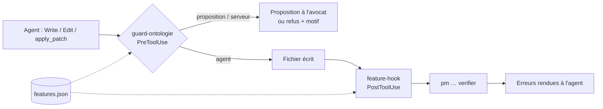

# Harness Legal

Couche de vérification des citations juridiques, portée depuis
https://github.com/open-legal-products/mike. Principe : **le modèle ne cite que
ce qu'il a lu dans le tour, et la vérification est mécanique** — recherche de
sous-chaîne tolérante aux espaces, à la casse et à la ponctuation, jamais un
jugement du modèle. Un extrait qui a dérivé est recalé sur le texte source (ce
n'est pas une faute) ; un extrait introuvable passe à `verified: false`.

Deux points de branchement distincts :

- **Proxy PII** : démarré et attendu dans `server/piecemaker/index.ts`, avant
  que CloudCLI puisse écouter. `anonymizer/lifecycle.ts` refuse le démarrage si
  le proxy ou le routage Claude/Codex n'est pas prêt ; les lancements de chat
  revérifient cet état. Le proxy appartient au processus serveur et disparaît
  avec lui. Le fournisseur Codex géré utilise HTTP Responses, pas WebSocket.
- **Harnais de chat** : `harness/chat-harness.ts` décore les services publics
  `providerRuntimeService.run/getRunner` et `sessionsService.fetchHistory`.
  Il traite les événements normalisés Claude/Codex avant leur diffusion et
  leur mise en tampon pour reconnexion. Aucun fichier CloudCLI upstream n'est
  modifié. Le terminal PTY brut n'est pas une conversation structurée : cette
  visionneuse et ces annotations concernent le chat, pas son affichage ANSI.

- **Cache des décisions** `~/.piecemaker/decisions/<id>.json` — un seul cache,
  écrit là où les décisions sont téléchargées : `tools/decision_cache.py` dans
  le MCP Légifrance (Claude, Codex, Mistral) et `decision-cache.ts` dans
  l'analyse tabulaire. Il garde la réponse brute de `/consult/juri` ou de
  Judilibre `/decision`, sans expiration, jamais les erreurs ni les textes vides.
  Une entrée sans réponse brute est retéléchargée puis remplacée. Le contrôle
  d'historique de `consulter_decision` y est gardé pour la journée. Les
  recherches et les articles restent en direct : leur résultat peut changer.
- `server/piecemaker/harness/decisions.cjs` — extrait le texte intégral et le
  titre d'un résultat `consulter_decision` ou `consulter_article`.
- `server/piecemaker/harness/citation-turn.ts` — comportement de Mike : texte
  diffusé progressivement, bloc `<CITATIONS>` masqué même découpé,
  vérification mécanique puis fin du tour. Un bloc JSON valide terminé à EOF
  est aussi accepté si sa balise fermante manque.
  Les décisions viennent seulement des résultats `consulter_decision` de ce
  tour, appariés par `toolId` ; le cache évite l'appel API, pas cet appel d'outil.
  Les Markdown sont résolus dans le dossier réel de la session, avec contrôle
  des liens symboliques et lecture mémoïsée par tour. Les moteurs de parsing
  et de vérification vendorisés restent inchangés.
- `server/piecemaker/harness/citation-store.ts` — snapshots locaux privés des
  textes ayant servi à vérifier les extraits, avec leurs positions. Les liens
  utilisent des empreintes opaques ; la route de lecture est authentifiée et
  refuse les sessions supprimées. Ces snapshots contiennent du texte réel,
  contrairement au journal `citations-verifiees.jsonl` qui ne contient
  **aucun extrait ni texte source**, et utilise l'identifiant de session.
  Lorsqu'une décision n'avait pas été lue dans le tour, la visionneuse peut
  ouvrir sa copie déjà présente dans `decisions/` : elle cherche mécaniquement
  le passage pour la consultation, sans modifier le `verified: false` initial.
  Cette provenance est affichée explicitement ; le snapshot reste inchangé.
- `src/piecemaker/citations/` — liens Markdown natifs du chat, source ouverte
  dans un onglet de l'éditeur latéral de CloudCLI (`src/piecemaker/editor-tabs/`),
  sélection d'extrait, surlignage des positions vérifiées, avertissement des
  extraits introuvables. Réutilise l'API authentifiée et les composants
  Button/ScrollArea de CloudCLI.
  Le lien « Ouvrir ce passage sur Légifrance » utilise les fragments de texte
  du navigateur et un nouvel onglet. L'intégration directe testée en iframe
  est refusée par Légifrance (HTTP 403, `X-Frame-Options: SAMEORIGIN`).
- `server/piecemaker/harness/citation-instructions.ts` — discipline de lecture
  et format JSON ajoutés aux requêtes de chat Claude/Codex/Mistral, retirés des
  messages utilisateur et des réponses assistant (flux et historique ; les
  échos assistant sans balise fermante sont coupés), y compris sous la forme aplatie
  par `flattenPromptForWindowsShell` que Vibe stocke sous Windows, et en CRLF,
  ainsi que des titres de session (`normalizeSessionName`) et de la recherche
  (`session-conversations-search.service.ts`). Les commandes slash sont
  préservées. Une question posée en commentaire d'un `.docx` part sans le
  bloc (`docs/docx.md`).
- Liste **Sources** en fin de réponse (`finish` de `citation-turn.ts`), une
  ligne par citation, dérivée de la seule sortie du vérifieur (inchangé) :
  `[n]`, titre lié au panneau, extraits vérifiés entre guillemets. Titre d'une
  décision ou d'un article : le titre Légifrance tel quel. Titre d'une pièce :
  lu en base par `harness/piece-title.ts` (label `AAAA-MM-JJ_titre`, sinon
  nature + date, sinon nom du fichier) ; l'IA ne donne que `doc_id`. Tout
  extrait non vérifié porte « citation non retrouvée, à vérifier ». Quand
  `nearestPassage` (`source-passages.ts`) trouve un passage proche, la citation
  est validée : pas de pastille, l'extrait source remplace la paraphrase du
  modèle dans le snapshot, la liste Sources, et le surlignage du document.
  La liste calculée en direct est conservée (`citation-sources/turns/`, clé :
  session + bloc `<CITATIONS>`) et reprise telle quelle par l'historique : le
  texte rechargé est identique au texte diffusé, le client les fusionne, et
  les sources lues dans un `exec` Codex (invisibles à la relecture) restent
  vérifiées. Une réponse Codex non diffusée en deltas est retenue jusqu'à la
  fin du tour pour n'être envoyée qu'une fois, avec sa liste.
- Mistral (Vibe) passe aussi par le harnais : sa réponse n'arrive qu'en
  deltas (ni `stream_end` ni message final), la liste est donc ajoutée en
  dernier delta avant `complete`. Vibe nomme les outils
  `legifrance_consulter_decision` (un seul `_`) et porte le résultat sur le
  `tool_use` (`toolResult`) : les deux formes sont reconnues. Les recherches
  `Search_*` sont réservées à `research-maker` : hook `guard-legal-search`
  sous Claude et Codex (approuvé au démarrage dans `~/.codex/config.toml`,
  appels dans un `exec` compris), outils retirés de l'agent principal dans le
  chat Mistral. `consulter_article` et `consulter_decision` restent ouverts à
  tous. Après `research-maker`, `verify-subagent` signale les décisions citées
  jamais lues, y compris dans le chat Mistral. Sous Windows,
  le pont `cmd` conserve les guillemets et chaînages de commandes ; le chemin
  de Python du venv est ajouté au `PATH`.
- Dans un `.docx`, l'instruction demande une note de bas de page au lieu de
  `[n]`, et le même bloc `<CITATIONS>` dans le chat (ref = numéro de note) :
  les notes sont donc vérifiées comme le chat. Rien ne contrôle encore que le
  texte de la note égale l'extrait vérifié.

Le proxy d'anonymisation n'observe plus rien : il réécrit le trafic et ne touche
ni au cache ni aux citations.

**Comme Mike, ce harnais annote, il ne bloque pas la prose déjà diffusée.** Un
extrait corrigé reçoit le texte exact ; un extrait introuvable reste visible
avec un avertissement, jamais avec un faux surlignage. Un tour interrompu ne
publie pas d'annotations finales. L'ancien hook Stop `verify-citations.mjs` est
retiré : `DEPRECATED_HOOKS` de `websocket-server/claude-hooks.cjs`.

Le format exact du bloc `<CITATIONS>` est injecté à chaque tour par
`server/piecemaker/harness/citation-instructions.ts`.

## Le Hérisson : registre et vérification automatique

Le Hérisson est la feature centrale qui garde et vérifie les écritures de l'agent.

Un seul registre décrit les fichiers que l'agent écrit dans `.piecemaker/` :
`server/piecemaker/vendor/piecemaker-plugin/features.json`. Deux hooks le
lisent, pour tous les clients (Claude, Codex, Vibe, chat Mistral de l'app) :

- **avant l'écriture** (PreToolUse) : `guard-ontologie.mjs` transforme en
  proposition, ou refuse, l'écriture des features gardées. Le message renvoyé
  à l'agent est le `motif` du registre ;
- **après l'écriture** (PostToolUse) : `feature-hook.mjs` lance le
  vérificateur `pm` de la feature touchée et rend sa sortie à l'agent
  (40 lignes au plus), avec la consigne de corriger avant de continuer.

Le raisonnement YAML (`.piecemaker/raisonnements/`) n'est pas une feature du
registre : sa vérification reste lancée par l'agent (`pm raisonnement verifier`).

Les sous-agents gardent leur propre contrôle de fin : `verify-subagent.mjs`
(inchangé).

### Fonctionnement par feature

| Feature | Fichiers (sous `.piecemaker/`) | Écriture | Avant (PreToolUse) | Après (PostToolUse) | Skill | Délai |
|---|---|---|---|---|---|---|
| `ontologie` | `ontologie.json` (dans `~/.piecemaker`) | proposition | devient une proposition (onglet Index › Ontologie) | — | `okf` | — |
| `arborescence` | `arborescence.json` | proposition | devient une proposition (onglet Index › Classement) | — | `piecemaker` | — |
| `okf` | `okf/**` | serveur | refusée : `pm okf link` / `unlink` | — (contrôle par `pm okf link`, puis `verify-subagent`) | `okf` | 30 s |
| `suivi` | `<nom>-suivi.json`, `suivi.json` | agent | libre | `pm suivi_dossiers verifier --suivi <fichier>` | `piecemaker` | 60 s |
| `catala` | `catala/<nom>/*.catala_fr`, `*.toml` | agent | libre | `pm catala verifier --programme <nom>` | `catala` | 60 s |

Branchements :

| Client | Avant | Après |
|---|---|---|
| Claude | `hooks.json` du plugin, matcher `Write\|Edit\|MultiEdit\|NotebookEdit\|Bash\|…` | `hooks.json`, matcher `Write\|Edit\|MultiEdit\|NotebookEdit`, 90 s |
| Codex | `~/.codex/hooks.json`, `^(Bash\|apply_patch)$` | `~/.codex/hooks.json`, `post_tool_use`, `^apply_patch$`, 90 s, approuvé dans `config.toml` |
| Vibe | `~/.vibe/hooks.toml`, `piecemaker-guard-ontologie` | `~/.vibe/hooks.toml`, `piecemaker-feature-check`, 90 s |
| Chat Mistral | `guard()` de `mistral-sdk/tools.ts` | `checked()` après Write et Edit, ajouté au résultat de l'outil |

### Durée de chaque vérification

Mesures sur un Mac de 8 Go, dossier fictif (6 pièces, un suivi, un programme
Catala).

| Vérificateur | Durée mesurée | Ce qui coûte |
|---|---|---|
| `pm catala verifier` | 21,5 s au premier lancement, 6,0 s ensuite | compilation Catala |
| `pm okf verify` (cœur, 6 pièces) | 44 ms à froid, 14 ms ensuite | — |
| `pm okf verify` (aller-retour `pm` + serveur) | 0,25 à 1,5 s | lancement de `pm` |
| `pm okf verify` (≈ 2 000 documents) | 5,2 s | lecture des fiches |
| `pm suivi_dossiers verifier` (cœur, sans réseau) | 25 ms à froid, 2 ms ensuite | — |

Limites des mesures :

- la vérification en ligne des citations du suivi n'est pas mesurée ;
- `pm okf verify` et `pm suivi_dossiers verifier` n'ont pas été mesurés de
  bout en bout sur un dossier enregistré dans l'app ;
- le premier `pm catala verifier` dépasse 20 s : le délai de la feature est
  donc de 60 s, et celui du hook de 90 s.

### Ajouter une feature

1. Ajoutez une entrée dans `features.json` : `nom`, `cible` (expression
   régulière sur le chemin relatif à `.piecemaker/`, groupe `nom` facultatif),
   `ecriture`, `skill`, et `motif` (feature gardée) ou `verifier` et `delai`
   (feature écrite par l'agent). `{nom}` dans `verifier` reçoit le groupe `nom`.
2. Ajoutez un cas dans `scripts/feature-hook.test.js`.

Aucun hook n'est à modifier. Limite : une écriture par le shell (`Bash`) ne
déclenche pas la vérification après écriture.
