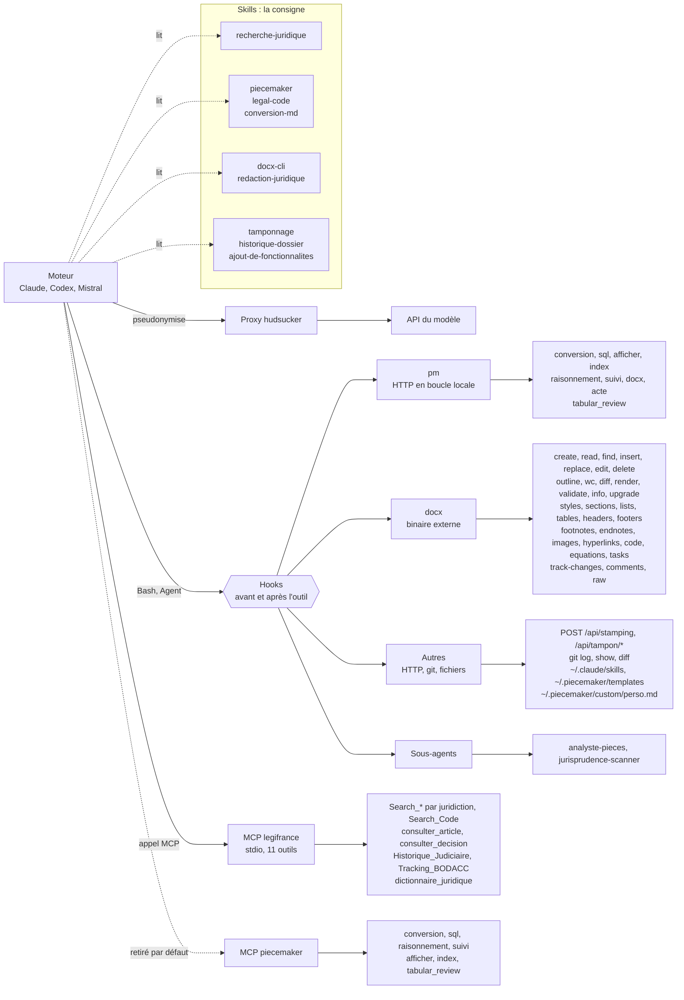

# Inventaire des outils de l'assistant

Cette carte réunit les serveurs MCP, les skills, les outils et les commandes de l'assistant. Le détail de chaque fonction reste dans sa propre doc.

Le moteur lit un skill, puis appelle un outil. Le skill n'appelle ni le moteur ni un outil.

Le canal Légifrance ne passe pas par les hooks : leurs filtres visent `Read`, `Grep`, `Glob`, `Bash` et `Write`, pas les outils MCP.

## Serveurs MCP

| Serveur | État | Source | Outils |
|---|---|---|---|
| `legifrance` | déclaré dans chaque dossier | `server/piecemaker/vendor/mcp/legifrance/config/mcp_definitions.py` | `Search_Cour_Cassation`, `Search_Cour_Appel`, `Search_Conseil_Etat`, `Search_CAA`, `Search_Premiere_Instance`, `Search_Code`, `consulter_article`, `consulter_decision`, `Historique_Judiciaire`, `Tracking_BODACC`, `dictionnaire_juridique` |
| `piecemaker` | retiré par défaut (`RETIRED_SERVERS`), gardé pour un client MCP sans shell | `server/piecemaker/vendor/mcp/piecemaker/server.mjs` | `conversion`, `sql`, `raisonnement`, `suivi`, `afficher`, `index`, `tabular_review` |

La déclaration par dossier se fait dans `server/piecemaker/mcp-declaration.ts`.

L'étape `07-legifrance` de l'installateur vise un autre serveur, le plugin `piecemaker@mcp-legifrance` : son dépôt est externe, et il expose `Search_Jurisprudence` à la place des cinq outils par juridiction. Ce tableau décrit le serveur embarqué.

## Commande `pm`

Point d'entrée de l'assistant : `server/piecemaker/vendor/skills/Skill-PieceMaker/scripts/pm.mjs`, copié dans `.agents/skills/` de chaque dossier. Le serveur PieceMaker doit tourner.

| Commande | Sous-commandes ou options |
|---|---|
| `pm conversion` | `[pièce…]`, `--dossier`, `--force` |
| `pm sql` | `--requete`, `--dossier` |
| `pm afficher` | `--fichier`, `--volet dossier\|index\|tabular-review\|tampon`, `--review`, `--fermer` |
| `pm index` | `lister`, `modifier` |
| `pm raisonnement` | `consignes`, `verifier`, `lister` |
| `pm suivi` | `verifier`, `lire`, `ecrire` |
| `pm docx` | `preparer`, `verifier`, `comparer`, `extraire` |
| `pm acte` | `exporter`, `fusionner`, `importer` |
| `pm tabular_review` | `lister`, `ouvrir`, `documents`, `modeles`, `enregistrer_modele`, `preparer`, `lancer`, `index`, `lire`, `colonnes`, `classement`, `arborescence`, `relancer` |

Le volet `chronologie` s'appelle désormais `index`. La commande `pm index` porte le même nom.

| Commande | Effet | Lit les pièces |
|---|---|---|
| `pm afficher --volet index` | ouvre l'onglet Index du volet Dossier | non |
| `pm tabular_review index` | retrouve ou prépare l'unique analyse de toutes les pièces, puis l'ouvre dans le volet Dossier | oui, au lancement |
| `pm index lister\|modifier` | lit ou modifie les dates et les libellés des pièces en base | non |

La commande `piecemaker` est un lanceur pour le développeur, pas un outil de l'assistant : `docs/cli-piecemaker.md`.

## Skills

| Skill | Source | Public | Appelle |
|---|---|---|---|
| `piecemaker` | `server/piecemaker/vendor/skills/Skill-PieceMaker/` | assistant | `pm` |
| `docx-cli` | `server/piecemaker/vendor/skills/docx-cli/` | assistant | `docx` |
| `redaction-juridique` | `server/piecemaker/vendor/piecemaker-plugin/skills/` | assistant | `docx` |
| `legal-code` | `.agents/skills/legal-code/` | assistant, session `/legal-code` | `pm raisonnement`, `pm sql` |
| `recherche-juridique` | `server/piecemaker/vendor/piecemaker-plugin/skills/` | assistant | MCP `legifrance`, `pm tabular_review` |
| `conversion-md` | idem | assistant | `pm conversion` |
| `tamponnage` | idem | assistant | `POST /api/stamping`, `/api/tampon/*` |
| `historique-dossier` | idem | assistant | `git log`, `git show`, `git diff` |
| `ajout-de-fonctionnalites` | idem | assistant | `~/.claude/skills`, `~/.piecemaker/templates`, `~/.piecemaker/custom/perso.md` |
| `verifieur-raisonnement` | `.agents/skills/` | développeur | `pm raisonnement`, `pm acte` |
| `backend-module-standards` | `.agents/skills/` | développeur | aucun |
| `frontend-module-standards` | `.agents/skills/` | développeur | aucun |
| `electron-cloudcli` | `.agents/skills/` | développeur | aucun |

`server/piecemaker/skill-declaration.ts` déclare `docx-cli`, `redaction-juridique` et `Skill-PieceMaker` dans chaque dossier. L'installateur enregistre les autres skills de `piecemaker-plugin` dans `~/.claude` et `~/.codex/skills`. Mistral lit `~/.vibe/skills` et `~/.agents/skills`, mais l'installateur n'y écrit rien.

## Sous-agents

| Agent | Modèle | Outils |
|---|---|---|
| `analyste-pieces` | sonnet | `Read`, `Grep`, `Glob`, `Bash` |
| `jurisprudence-scanner` | haiku | `Read`, `Write` |

## Hooks

| Hook | Moment | Outils visés |
|---|---|---|
| `protect-originals` | avant | `Read\|Grep\|Glob\|Bash` |
| `guard-secrets` | avant | global, hors plugin |
| `track-legifrance-reads` | après | `Read` |
| `compile-recherche` | après | `Write` |
| `classify-ai-documents` | après | `Write\|Bash` |

Codex reçoit la protection des pièces dans `~/.codex/hooks.json`. Mistral exécute `protect-originals` et `guard-secrets` en code avant ses outils intégrés : `server/piecemaker/mistral-sdk/tools.ts`.

## Accès par moteur

| Élément | Claude | Codex | Mistral |
|---|---|---|---|
| MCP `legifrance` | `.mcp.json` | `.codex/config.toml` | `.vibe/config.toml` |
| Skills du dossier | `.claude/skills` | `.agents/skills` | `.agents/skills`, outil `skill` |
| Sous-agents | `~/.claude` | `.codex/agents`, depuis la Bibliothèque seulement | `.vibe/agents`, depuis la Bibliothèque seulement |
| `pm`, `docx` | Bash | Bash | Bash |

Cursor, OpenCode et Grok reçoivent aussi la déclaration du MCP `legifrance` et les liens des skills.

## Volets de l'interface

Les plugins de `plugins/` servent l'avocat et ne déclarent aucun outil IA : `piecemaker-dossier`, `piecemaker-echeances`, `piecemaker-library`, `piecemaker-raisonnement`, `piecemaker-tabular-review`, `piecemaker-tampon`, `piecemaker-timesheet`.

## Maintenance

Mettez à jour ce fichier quand un outil, un skill ou une commande change. Les sources de référence sont `mcp_definitions.py`, `server.mjs`, `pm.mjs`, `docx --help` (version 0.24.0) et les `SKILL.md`.
