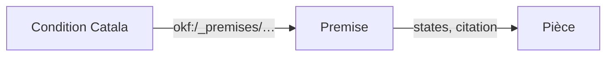

# Index OKF du dossier

L'index du dossier suit Open Knowledge Format 0.2, avec les relations typées d'OKF-Legal. Le format n'est pas réinventé : frontmatter YAML, `type` obligatoire, `generated`, identifiants bundle-relatifs, `index.md` avec `okf_version`.

## Autorité

SQLite fait foi. Les prémisses, les liens cités et les examens sans lien sont dans les tables `piecemaker_okf_premises`, `piecemaker_okf_relations` et `piecemaker_okf_exams` (`server/piecemaker/okf/store.ts`). Les personnes, pseudonymes, mentions et qualifications de partie sont dans les tables de la connaissance. Les fiches `.md` de `.piecemaker/okf/` sont des vues : le serveur les régénère depuis SQLite après chaque écriture dans la base. Une fiche modifiée ou supprimée à la main est réécrite à la reconstruction suivante. Une prémisse n'existe que par un lien `states` cité.

Les fiches écrites avant que SQLite ne porte ces données sont importées une seule fois par dossier (`piecemaker_okf_imports`). Les fiches Partie portent des codes, pas des noms. Les citations et les titres de pièces sont en clair et peuvent contenir des identités réelles.

## Périmètre

`.piecemaker/okf/` contient :

| Fiche | Identifiant | Origine |
| --- | --- | --- |
| Document | `/<chemin du document>.md` | scan |
| Prémisse (`Premise`) | `/_premises/<titre normalisé>.md` | avocat ou agent |
| Partie | `/_parties/<CODE>.md` | personnes qualifiées client ou adversaire |
| `index.md` | — | reconstruction |

Seules les personnes qualifiées de parties ont une fiche. Les tiers n'entrent pas dans l'OKF.

## Types

Le type principal d’une fiche suit le champ `type` du dossier, hérité du parent. Sans ce champ, le nom du dossier de premier niveau reste le type. Sans arborescence, la classification par défaut s’applique. Un document hors arborescence reçoit `Non classé` ; la vérification le signale. `Premise` et `Partie` sont réservés.

Le graphe ne montre que certains types de documents : ceux que relie l'ontologie (sources et cibles de ses relations). Sans ontologie : `['Pièces']`. Il montre aussi les parties, et les prémisses sur demande.

L'avocat seul fixe l'arborescence, donc les types de documents. Elle est commune à tous les dossiers : c'est la clé `arborescence` de `~/.piecemaker/ontologie.json`, scellée avec les relations et les natures. Au premier démarrage, la plus récente des anciennes `.piecemaker/arborescence.json` des dossiers devient l'arborescence commune ; ces fichiers ne sont plus lus. L'agent la lit avec `pm dossier arborescence` et modifie la clé `arborescence` de `ontologie.json` avec Edit, Write ou apply_patch : le hook `guard-ontologie` refuse l'écriture, applique la modification à la proposition en attente (ou au fichier actuel), la fait valider par `pm okf ontologie proposer` et répond à l'agent ce qui a changé. Sans hook, l'agent propose une arborescence complète avec `pm dossier arborescence --dossiers JSON --motif "…"`. La proposition est écrite dans `ontologie.proposition.json`, avec celle des relations et des natures ; elle ne s'applique pas. L'onglet Index › Classement la montre en suivi des modifications, comme l'ontologie : l'avocat accepte, refuse ou modifie chaque changement, puis enregistre, ce qui retire l'arborescence de la proposition (`DELETE /classification/proposition` du plugin Tabular review pour « Tout refuser »). L'enregistrement met à jour la colonne Classement des revues de tous les dossiers. Un bandeau de l'onglet Index signale les propositions en attente, d'ontologie et d'arborescence.

## Ontologie

`~/.piecemaker/ontologie.json` (ou `$PIECEMAKER_HOME/ontologie.json`), un seul fichier commun à tous les dossiers : `{ "relations": [{ name, label, inverse, description, source: [types], target: [types] }], "documentTypes": [{ name, icon }], "arborescence": [{ name, explanation, type? }], "sceau" }`. Une relation ne s'applique que dans les dossiers où ses types existent. Sans fichier, chaque dossier reçoit l'ontologie par défaut : les quatre relations ci-dessous entre documents des types du graphe. Un fichier illisible fait appliquer l'ontologie par défaut, avec un message.

Le serveur scelle le fichier à chaque enregistrement : `sceau` est un HMAC-SHA256 des relations, du catalogue des natures et de l'arborescence, calculé avec la clé `ontologie.cle` du même répertoire (créée au premier enregistrement, mode 600). Un fichier dont le sceau ne correspond pas a été modifié hors de l'onglet Index : l'ontologie par défaut s'applique, `verify` et l'onglet Index le signalent, et l'avocat l'enregistre de nouveau.

- L’avocat règle les relations dans l’onglet Index, bouton Ontologie. Chaque lien montre son nom technique, son libellé, son libellé inverse et sa description. Un nouveau lien relie `Pièces` à `Pièces`. L’enregistrement conserve les types source et cible existants. Les relations système restent réservées.
- L'agent la lit avec `pm okf ontologie`. Il propose une modification en éditant `ontologie.json` (Edit, Write ou apply_patch) : le hook `guard-ontologie` refuse l'écriture, applique la modification à la proposition en attente (ou au fichier actuel), la fait valider par `pm okf ontologie proposer` et répond à l'agent ce qui a changé. Sans hook, il lance `pm okf ontologie proposer --json '{"relations":[…],"documentTypes":[…],"arborescence":[…],"motif":"…"}'` (au moins une des trois listes). Chaque liste fournie remplace celle de la proposition en attente ; les autres sont conservées. La proposition est écrite dans `ontologie.proposition.json` (même répertoire, non scellé, une seule proposition à la fois), avec les seules listes qui diffèrent de l'ontologie actuelle. Le serveur refuse une proposition dont une clé manque, est inconnue ou enfreint les règles, et liste toutes les erreurs. Elle ne s'applique pas. L'onglet Index › Ontologie la montre en suivi des modifications (ajout, modification, suppression ; texte retiré barré, texte ajouté souligné). L'avocat accepte, refuse ou modifie chaque changement, puis enregistre : seuls les changements acceptés ou modifiés passent dans l'ontologie, le reste est écarté, et l'enregistrement supprime la proposition (`DELETE /api/piecemaker/okf/ontologie/proposition` pour « Tout refuser »).
- L'avocat interroge l'assistant sur l'ontologie : bouton « Demander à l’assistant » (toute l'ontologie) ou « ? » d'une relation. La pastille du chat transmet `ontologie.json` et les lignes de la relation (`lignes` dans la réponse du `GET`). `pm okf link` refuse une relation absente de l'ontologie ou un type source ou cible non admis.
- `verify` signale chaque lien hors ontologie, y compris un lien posé avant une modification de l'ontologie.
- `verify` contrôle aussi `ontologie.json` et `ontologie.proposition.json` : clés de premier niveau (`relations`, `documentTypes`, `arborescence`, `motif`, `sceau`, `date`), clés de chaque relation (`name`, `label`, `inverse`, `description`, `source`, `target`) et de chaque type (`name`, `icon`), présentes et sans clé inconnue, puis valeurs conformes aux règles (nom, longueurs, types réservés, doublons, icône connue).
- Les libellés du tableau et du graphe suivent l'ontologie.
- Le hook `guard-ontologie` refuse à l'agent toute écriture directe dans `~/.piecemaker/ontologie.json` (relations, natures et arborescence), et tout accès à `ontologie.cle`. Il est branché sous Claude (`Write|Edit|MultiEdit|NotebookEdit|Bash|Read|Grep|Glob`), sous Codex (`Bash|apply_patch`, patch lu dans `tool_input.command`) et dans le chat Mistral (`mistral-sdk/tools.ts`, avec `protect-originals`).
- L'agent écrit les liens par l'outil MCP `OkfWrite` (serveur `features`) : `link`, `unlink`, `mark_examined`, une ou plusieurs opérations par appel (`writes`), toutes validées avant la première et arrêtées au premier échec. Son schéma n'admet que les relations de l'ontologie, plus `states` et `involves` ; il les reçoit du serveur au démarrage (`pm okf ontologie --noms`), qui vérifie le sceau : une ontologie modifiée hors de l'onglet Index n'y entre pas. Il exige la citation sauf pour `involves`. Il passe par `pm okf link|unlink|examinee`, donc par la vérification du serveur. Aucun hook ne refuse plus l'écriture dans `.piecemaker/okf/` ; le Hérisson lance `pm okf verify` après toute écriture d'une fiche.
- Une commande shell qui nomme l'un de ces fichiers n'est admise que si chacun de ses segments est une lecture (`cat`, `grep`, `jq` sans `-i`, `find` sans `-delete` ni `-exec`, `pm`…), sans redirection vers un fichier ni substitution de commande.

## Relations

Dans le frontmatter de la fiche source : `relations: { <relation>: [{ target, citation, value?, origin, dismissed? }] }`.

| Relation | Source → cible | Citation | Posée par |
| --- | --- | --- | --- |
| relations de l'ontologie (par défaut `amends`, `responds-to`, `refers-to`, `supersedes`) | document → document (types admis par la relation) | oui | scan (`refers-to`), agent, avocat |
| `states` | document → Premise | oui, plus `value` facultative | avocat (visionneuse), agent |
| `mentions` | document → Partie | oui | scan seulement |
| `involves` | Premise → Partie | non | agent |

`supersedes` relie une version à celle qu'elle remplace. Aucun champ de statut (projet, signé) n'existe.

`origin` vaut `piecemaker/gliner`, `piecemaker/agent` ou `piecemaker/avocat`. Un lien dérivé du scan retiré est marqué `dismissed` et ne revient pas. Un lien manuel retiré est supprimé.

## Prémisses

Une prémisse est un point que le raisonnement tient pour établi : un fait, ou une clause d'un contrat. C'est une fiche `Premise` : `title`, `description`, `single_value` facultatif. Son corps liste les pièces qui l'établissent (vue dérivée ; le lien dans la fiche de la pièce fait foi). Aucun type `Clause` n'existe : la clause est une prémisse établie par le contrat.

Un index antérieur (`Fait`, `/_faits/`) est migré à la reconstruction suivante : fiches, liens et cibles passent sous `/_premises/`.

Deux sources :

1. **Visionneuse** — l'avocat sélectionne un passage, clic droit, « Prémisse », choisit ou crée la prémisse. Le passage devient la citation du lien `states`.
2. **Agent** — `pm okf link <pièce> states "<titre>" --citation "…" [--value "…"] [--single]`.

La revue tabulaire ne crée ni ne supprime de prémisse.

`single_value` marque une prémisse vue par plusieurs pièces qui doit garder une seule valeur : un écart entre pièces est une contradiction. Sans ce marquage, des valeurs différentes sont attendues (un point de contrôle appliqué à chaque contrat).

Une prémisse vit tant qu'un lien `states` la vise. Retirer son dernier lien la supprime.

## Raisonnement Catala

Le raisonnement Catala se branche sur la prémisse, pas sur la pièce.

1. Un fait de scénario Catala se justifie par une prémisse : `## okf:/_premises/<titre normalisé>.md` juste au-dessus de lui.
2. Une prémisse se justifie par des pièces citées (`states`).
3. Une condition ne cite jamais une pièce directement.

`pm catala verifier` développe chaque lien `okf:/_premises/…` du programme en ses pièces et contrôle chaque citation. Le volet Catala affiche ces pièces sous l'étape.

## Production, sans token

1. Le scan GLiNER remplit SQLite.
2. `buildBundle` écrit les fiches de documents (titre, nature, date), de parties et de prémisses, et pose `mentions`.
3. Le scan pose `refers-to` quand une phrase du Markdown converti contient la date et la nature d'un seul autre document.
4. `buildBundle` régénère toutes les fiches depuis SQLite et supprime les fichiers qui n'y correspondent pas.

La reconstruction a lieu après un scan, après un renommage (les cibles suivent dans SQLite) et après chaque écriture de lien ou d'examen. La lecture (`GET /okf`) et la vérification (`verify`) ne reconstruisent pas : elles lisent les fiches sur le disque. Un fichier n'est réécrit que si son contenu change.

Le serveur refuse une citation absente du document source.

## Vérification

`pm okf verify`, ou le bouton Vérifier de l'onglet Index. Trois listes :

- **Erreurs** : frontmatter, type, document présent, fiche alignée sur son document, relation connue et permise pour le type de la source, cible présente, citation retrouvée dans le document (apostrophes et guillemets typographiques, espaces insécables et ellipse « … » au milieu tolérés ; les fragments se suivent dans l'ordre), document sans fiche, `index.md`.
- **Contradictions** : prémisse `single_value` qui reçoit plusieurs valeurs distinctes (comparaison sans casse ni accents ; une valeur qui est une date est ramenée au format `AAAA-MM-JJ` avant comparaison : « 3 mars 2024 », « 03/03/2024 » et « 2024-03-03 » comptent pour une seule valeur).

`pm okf verify` donne aussi la liste **Manques**, pour l'agent. Chaque ligne nomme un élément et ce qui lui manque ; `pm check` les reprend :

| Élément | Manque signalé |
| --- | --- |
| Pièce d'un type du graphe | pièce à examiner : aucune prémisse ni lien vers une autre pièce ; ou pièce modifiée depuis son examen sans lien |
| Partie | aucune mention dans une pièce ni prémisse qui la concerne |
| Prémisse | aucune pièce citée ; valeur unique sans valeur ; aucune partie concernée (sans partie qualifiée au dossier : `avocat: true`, en attente de l'avocat, onglet Dossier, vue générale ; compté à part par `pm check`) |

**Pièce examinée sans lien.** Une pièce lue dont aucun passage ne justifie de lien ni de prémisse reste sinon un manque à jamais. L'agent (ou l'avocat) la marque : `pm okf examinee <pièce> --motif "raison"`. Le serveur écrit dans SQLite le motif, l'auteur, la date et l'empreinte SHA-256 du document original ; la fiche régénérée porte le champ `examen_sans_lien`. `verify` renvoie la pièce dans `examinees`, imprimée sous « Examinées sans lien (information, pas un manque) », et non dans les manques. Le manque revient si l'empreinte ne correspond plus au document (« pièce modifiée depuis son examen sans lien ») ou si la marque est retirée (`pm okf examinee <pièce> --retirer`). La fiche de la pièce, dans l'onglet Index, montre la ligne « Examen ». Le Hérisson lance `pm okf verify` après `pm okf examinee`, comme après `link`.

## Interface

Onglet Index du plugin `piecemaker-dossier` :

Le bouton **Ontologie** réunit trois onglets : Relations, Classement et Types de documents. Un seul bouton enregistre les onglets ouverts. Les saisies restent présentes lors du passage à un autre onglet.

- **Relations** conserve les types source et cible existants. Un nouveau lien relie `Pièces` à `Pièces`. Les propositions restent soumises aux décisions de l’avocat.
- **Classement** réutilise l’éditeur d’arborescence. Le champ `type` d’un dossier fixe son type principal, par exemple `Pièces` ou `Archives`. Les sous-dossiers héritent du parent. Sans champ `type`, le nom du dossier de premier niveau reste le type principal. L’enregistrement reconstruit l’index sans déplacer les fichiers.
- **Analyse tabulaire** ouvre la revue d’index du dossier, unique, dans une fenêtre de l’onglet. `pm dossier index lancer|lire|colonnes` et l’outil MCP `tabular_review_index` ouvrent la même fenêtre (vue `index-analysis`). Après un lancement par `pm` ou par l’outil MCP, la route hôte `/api/piecemaker/local/tabular-review` transmet l’origine du serveur : le runner du plugin range chaque ligne terminée selon la colonne Classement (`/api/piecemaker/local/rename`, puis `markApplied`), même si la revue n’est pas affichée. Un lancement fait depuis l’interface garde le rangement par le volet.
- **Types de documents** règle les natures et leurs icônes SVG monochromes. Le catalogue livré contient 17 natures : acte de procédure, courrier, courriel, mise en demeure, contrat, facture, devis, attestation, décision judiciaire, procès-verbal, constat, expertise, statuts de société, extrait Kbis, relevé bancaire, acte notarié et bordereau de pièces. L’extraction utilise « indéterminé » lorsqu’aucun type ne convient. L’avocat peut ajouter, renommer ou supprimer une nature, et choisir son icône. Supprimer une nature conserve les documents ; leur icône devient générique.

Le catalogue commun est stocké dans le champ `documentTypes: [{ name, icon }]` de l’ontologie. Le sceau couvre les relations et le catalogue. Les anciens sceaux restent lisibles et sont migrés à l’enregistrement. Enregistrer les relations conserve le catalogue.

L’agent lit les types principaux, natures et icônes avec `pm okf ontologie`. Il propose un catalogue en éditant `ontologie.json` (hook `guard-ontologie`) ou avec `pm okf types --json '[{"name":"contrat","icon":"pen"}]'`. La liste doit être complète. Elle rejoint la proposition en attente, comme les relations. L’onglet Types de documents la montre en suivi des modifications ; l’avocat accepte, refuse ou modifie chaque changement, puis enregistre.

Le graphe affiche des pastilles avec titre et icône, sur fond uni. Les traits sont fins ; les mentions et parties utilisent des pointillés. Le survol révèle les libellés proches. Le titre est extrait avec une citation vérifiée pendant la revue tabulaire et conservé dans `row.title`. Il remplace le nom source dans la première cellule, les exports et les en-têtes des fiches, sans colonne de question supplémentaire. Sans titre, le nom source reste affiché. Les anciennes colonnes `Titre`, `Intitulé`, `Titre du document` et `Nom du document` restent lues. `Événement` ne sert plus de titre. La nature vient du document, sinon des colonnes `Nature`, `Type de document`, `Type de pièce` ou `Type`. La lecture reflète les dernières réponses sans réécrire les fiches.

Routes ajoutées : `PUT /api/piecemaker/okf/types`, `POST /api/piecemaker/okf/rebuild`. Catalogue et sélecteur : `plugins/piecemaker-dossier/src/document-types.ts` et `document-types-editor.ts`.

- Tableau : colonne Liens (survol : citation).
- Graphe (cytoscape), onglet « Graphe » à côté de l'onglet « Index » (qui garde le tableau) : pièces et parties ; les prémisses sont masquées par défaut, la case « Afficher les prémisses » les montre avec leurs liens (choix gardé dans le navigateur) et le placement se recalcule. Nœuds placés au format du cadre (aire cible : trois fois celle des nœuds), écartés d'au moins 24 px en largeur et 12 px en hauteur, sans chevauchement ; les nœuds ne se déplacent pas. Le bouton ⌖ recentre le graphe entier. Un clic ouvre la fiche dans le même cadre, à droite, et cadre la vue sur le nœud et ses voisins ; × ou Échap la ferme. La fiche donne titre, méta, auteur et date de création (`generated`), actions, propriétés en pastilles (valeurs, parties, prémisses, liens), alertes (sources divergentes, aucune pièce), pièces sources avec fichier (un clic l'ouvre dans le volet Fichier), citation, auteur et date du lien (`at`, écrit par `pm okf link`). Pièce : « Corriger la pièce » ; partie : « Modifier la partie ». Une pastille ouvre la fiche liée. Fiche : `plugins/piecemaker-dossier/src/okf-card.ts`.
- Visionneuse : texte de la pièce, passages repérés surlignés (parties, date, citations des prémisses), section « Prémisses établies par la pièce » avec retrait. Les prémisses s'écrivent dans l'OKF dès le choix, par `POST /api/piecemaker/okf/link` et `/unlink`.

## Agent

Skill `okf` (`server/piecemaker/vendor/skills/okf/`), déclaré dans chaque dossier.

L'agent principal écrit lui-même l'index, par l'outil `OkfWrite` du MCP `features` ou par `pm okf`. Une prémisse ne se crée que pour une condition Catala qui la demande.

## Limites connues

- Un changement de code d'une partie laisse les liens `involves` pendants ; `verify` les signale.
- Les valeurs sont comparées comme des chaînes, sauf les dates (formats `JJ/MM/AAAA`, `JJ.MM.AAAA`, `AAAA-MM-JJ`, `J mois AAAA`) ramenées au format ISO.
- Une prémisse créée dans la visionneuse n'est pas `single_value` ; l'agent la pose avec `--single`.
- `pm okf verify` compare la valeur du scénario Catala (`définition … égal à`) aux valeurs des pièces de la prémisse seulement pour une date `|AAAA-MM-JJ|` ou un nombre ; les autres valeurs ne sont pas comparées.
- Le renvoi d'une clause à une autre n'a pas de relation propre, sauf si l'avocat en ajoute une à l'ontologie.
- Le CLI `vibe` exécute les hooks PieceMaker par `~/.vibe/hooks.toml`, écrit au démarrage du serveur (entrées `piecemaker-*` seulement, hooks personnels conservés) ; l'adaptateur `scripts/vibe-hook.mjs` traduit le protocole Vibe. Limite : sous le harnais expérimental de Vibe, `subagent.spawn` est asynchrone, son résultat ne porte pas le compte rendu : `verify-subagent` n'y voit rien. Le chat Mistral de l'app passe par `guard-ontologie`, `protect-originals`, `classify-ai-documents` et `verify-subagent`.
- Une commande qui fabrique le chemin sans le nommer (concaténation, variable) échappe au hook. Le sceau détecte alors une ontologie modifiée, et `verify` un lien hors ontologie posé dans une fiche.

## Fichiers

| Rôle | Fichier |
| --- | --- |
| Format, lecture, écriture | `server/piecemaker/okf/bundle.ts` |
| Construction depuis le scan | `server/piecemaker/okf/build.ts` |
| Tables SQLite de l'OKF | `server/piecemaker/okf/store.ts` |
| Métadonnées lues dans les revues tabulaires | `server/piecemaker/okf/reviews.ts` |
| Vérification, contradictions | `server/piecemaker/okf/verify.ts` |
| Pièces d'une prémisse, manques du graphe | `server/piecemaker/okf/premises.ts` |
| Liens à la demande | `server/piecemaker/okf/links.ts` |
| Ontologie des liens | `server/piecemaker/okf/ontology.ts` |
| Fichier scellé commun, arborescence | `server/piecemaker/okf/sealed.ts` |
| Éditeur de l'ontologie | `plugins/piecemaker-dossier/src/ontology.ts` |
| Proposition de l'assistant | `server/piecemaker/okf/ontology-proposal.ts`, `plugins/piecemaker-dossier/src/ontology-proposal.ts` |
| Suivi des modifications, commun | `plugins/piecemaker-dossier/src/proposal.ts`, `plugins/piecemaker-dossier/src/pending-proposals.ts` |
| Proposition d'arborescence | `plugins/piecemaker-tabular-review/src/server/classification.ts`, `plugins/piecemaker-dossier/src/classification.ts` |
| Garde d'écriture | `server/piecemaker/vendor/piecemaker-plugin/scripts/guard-ontologie.mjs` |
| Routes `/api/piecemaker/okf` et locale | `server/piecemaker/okf/index.ts` |
| Commande `pm okf` | `server/piecemaker/vendor/skills/Skill-PieceMaker/scripts/pm.mjs` |
| Tableau, graphe, appels | `plugins/piecemaker-dossier/src/okf.ts` |
| Visionneuse | `plugins/piecemaker-dossier/src/editors.ts` (`documentEditor`) |
