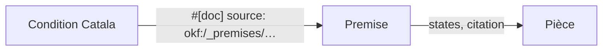

# Index OKF du dossier

L'index du dossier suit Open Knowledge Format 0.2, avec les relations typées d'OKF-Legal. Le format n'est pas réinventé : frontmatter YAML, `type` obligatoire, `generated`, identifiants bundle-relatifs, `index.md` avec `okf_version`.

## Autorité

L'OKF fait autorité sur les types, les liens entre pièces, les prémisses et le lien d'une pièce à une partie. Une prémisse n'existe que par un lien cité dans la fiche d'une pièce.

SQLite garde ce qui sert à l'anonymisation : personnes, pseudonymes, mentions, qualification de partie. L'OKF reflète cette qualification à chaque reconstruction. Les fiches Partie portent des codes, pas des noms. Les citations et les titres de pièces sont en clair et peuvent contenir des identités réelles.

## Périmètre

`.piecemaker/okf/` contient :

| Fiche | Identifiant | Origine |
| --- | --- | --- |
| Document | `/<chemin du document>.md` | scan |
| Prémisse (`Premise`) | `/_premises/<titre normalisé>.md` | avocat, agent ou revue tabulaire |
| Partie | `/_parties/<CODE>.md` | personnes qualifiées client ou adversaire |
| `index.md` | — | reconstruction |

Seules les personnes qualifiées de parties ont une fiche. Les tiers n'entrent pas dans l'OKF.

## Types

Le type d'une fiche de document est le dossier de premier niveau de `.piecemaker/arborescence.json`. Sans arborescence, la classification par défaut s'applique. Un document hors arborescence reçoit `Non classé` ; la vérification le signale. `Premise` et `Partie` sont réservés.

Le graphe ne montre que certains types de documents : ceux que relie l'ontologie (sources et cibles de ses relations). Sans ontologie : `['Pièces']` par défaut, ou `typesGraphe` dans `.piecemaker/okf.json`. Il montre aussi les prémisses et les parties.

L'avocat seul fixe les types de documents. Quand l'arborescence existe, `pm dossier arborescence` refuse à l'agent d'ajouter ou de retirer un dossier de premier niveau ; il ne change que les sous-dossiers et les explications.

## Ontologie

`~/.piecemaker/ontologie.json` (ou `$PIECEMAKER_HOME/ontologie.json`), un seul fichier commun à tous les dossiers : `{ "relations": [{ name, label, inverse, description, source: [types], target: [types] }], "sceau" }`. Une relation ne s'applique que dans les dossiers où ses types existent. Sans fichier, chaque dossier reçoit l'ontologie par défaut : les quatre relations ci-dessous entre documents des types du graphe. Un fichier illisible fait appliquer l'ontologie par défaut, avec un message.

Le serveur scelle le fichier à chaque enregistrement : `sceau` est un HMAC-SHA256 des relations, calculé avec la clé `ontologie.cle` du même répertoire (créée au premier enregistrement, mode 600). Un fichier dont le sceau ne correspond pas a été modifié hors de l'onglet Index : l'ontologie par défaut s'applique, `verify` et l'onglet Index le signalent, et l'avocat l'enregistre de nouveau.

- L'avocat l'édite dans l'onglet Index, bouton Ontologie (`GET`/`PUT /api/piecemaker/okf/ontologie`). Les types proposés sont ceux du dossier ouvert et ceux déjà employés par l'ontologie. `Premise` et `Partie` sont réservés ; les relations système (`states`, `mentions`, `involves`) ne se redéfinissent pas.
- L'agent la lit avec `pm okf ontologie`. `pm okf link` refuse une relation absente de l'ontologie ou un type source ou cible non admis.
- `verify` signale chaque lien hors ontologie, y compris un lien posé avant une modification de l'ontologie.
- Les libellés du tableau et du graphe suivent l'ontologie.
- Le hook `guard-ontologie` refuse à l'agent toute écriture directe dans `~/.piecemaker/ontologie.json`, `.piecemaker/arborescence.json` et `.piecemaker/okf/`, et tout accès à `ontologie.cle`. Il est branché sous Claude (`Write|Edit|MultiEdit|NotebookEdit|Bash|Read|Grep|Glob`), sous Codex (`Bash|apply_patch`, patch lu dans `tool_input.command`) et dans le chat Mistral (`mistral-sdk/tools.ts`, avec `protect-originals`).
- Une commande shell qui nomme l'un de ces fichiers n'est admise que si chacun de ses segments est une lecture (`cat`, `grep`, `jq` sans `-i`, `find` sans `-delete` ni `-exec`, `pm`…), sans redirection vers un fichier ni substitution de commande.

## Relations

Dans le frontmatter de la fiche source : `relations: { <relation>: [{ target, citation, value?, origin, dismissed? }] }`.

| Relation | Source → cible | Citation | Posée par |
| --- | --- | --- | --- |
| relations de l'ontologie (par défaut `amends`, `responds-to`, `refers-to`, `supersedes`) | document → document (types admis par la relation) | oui | scan (`refers-to`), agent, avocat |
| `states` | document → Premise | oui, plus `value` facultative | avocat (visionneuse), agent, revue tabulaire |
| `mentions` | document → Partie | oui | scan seulement |
| `involves` | Premise → Partie | non | agent |

`supersedes` relie une version à celle qu'elle remplace. Aucun champ de statut (projet, signé) n'existe.

`origin` vaut `piecemaker/gliner`, `piecemaker/agent`, `piecemaker/avocat` ou `piecemaker/tabular-review`. Un lien dérivé (scan, revue) retiré est marqué `dismissed` et ne revient pas. Un lien manuel retiré est supprimé.

## Prémisses

Une prémisse est un point que le raisonnement tient pour établi : un fait, ou une clause d'un contrat. C'est une fiche `Premise` : `title`, `description`, `single_value` facultatif. Son corps liste les pièces qui l'établissent (vue dérivée ; le lien dans la fiche de la pièce fait foi). Aucun type `Clause` n'existe : la clause est une prémisse établie par le contrat.

Un index antérieur (`Fait`, `/_faits/`) est migré à la reconstruction suivante : fiches, liens et cibles passent sous `/_premises/`.

Trois sources :

1. **Visionneuse** — l'avocat sélectionne un passage, clic droit, « Prémisse », choisit ou crée la prémisse. Le passage devient la citation du lien `states`.
2. **Agent** — `pm okf link <pièce> states "<titre>" --citation "…" [--value "…"] [--single]`.
3. **Revue tabulaire** — une colonne de modèle marquée « Index du dossier » porte une prémisse. Chaque cellule avec une citation vérifiée devient un lien : valeur = résumé de la cellule, citation = première citation vérifiée.

Deux usages de la colonne :

| Marquage | Usage | Écart entre pièces |
| --- | --- | --- |
| `single` | contentieux : une prémisse vue par plusieurs pièces | contradiction signalée |
| `checkpoint` | due diligence : un point de contrôle appliqué à chaque contrat | résultat attendu |

Une fiche `Premise` vit tant qu'une colonne de revue la porte ou qu'un lien non écarté la vise. Sinon la reconstruction la supprime.

La fiche d'une prémisse porte un bouton « Revue tabulaire ». Il crée un projet de revue à une colonne qui porte la prémisse (`single` si la prémisse est à valeur unique, sinon `checkpoint`) et l'ouvre.

## Raisonnement Catala

Le raisonnement Catala se branche sur la prémisse, pas sur la pièce.

1. Une condition Catala se justifie par une prémisse : `source: okf:/_premises/<titre normalisé>.md` dans son `#[doc]`, sans `quote`.
2. Une prémisse se justifie par des pièces citées (`states`).
3. Une condition ne cite jamais une pièce directement.

`pm catala verifier` développe la prémisse en ses pièces et contrôle chaque citation. Le volet Catala affiche ces pièces sous l'étape.

## Production, sans token

1. Le scan GLiNER remplit SQLite.
2. `buildBundle` écrit les fiches de documents (titre, nature, date), de parties et de prémisses, et pose `mentions`.
3. Le scan pose `refers-to` quand une phrase du Markdown converti contient la date et la nature d'un seul autre document.
4. `premisesFromReviews` lit `Tabular Review/*.json` et pose les liens `states` des colonnes marquées.

La reconstruction a lieu après un scan, après un renommage (les cibles suivent) et après chaque écriture de lien. La lecture (`GET /okf`) et la vérification (`verify`) ne reconstruisent pas : elles lisent les fiches sur le disque. Un fichier n'est réécrit que si son contenu change.

Le serveur refuse une citation absente du document source.

## Vérification

`pm okf verify`, ou le bouton Vérifier de l'onglet Index. Trois listes :

- **Erreurs** : frontmatter, type, document présent, fiche alignée sur son document, relation connue et permise pour le type de la source, cible présente, citation retrouvée dans le document (apostrophes et guillemets typographiques, espaces insécables et ellipse « … » au milieu tolérés ; les fragments se suivent dans l'ordre), document sans fiche, `index.md`.
- **Contradictions** : prémisse `single_value` qui reçoit plusieurs valeurs distinctes (comparaison sans casse ni accents ; une valeur qui est une date est ramenée au format `AAAA-MM-JJ` avant comparaison : « 3 mars 2024 », « 03/03/2024 » et « 2024-03-03 » comptent pour une seule valeur).

`pm okf verify` donne aussi la liste **Manques**, pour l'agent. Chaque ligne nomme un élément, ce qui lui manque et, s'il y a lieu, le programme Catala concerné ; `pm check` range ces manques sous chaque raisonnement :

| Élément | Manque signalé |
| --- | --- |
| Pièce d'un type du graphe | aucune prémisse ni lien vers une autre pièce |
| Partie | aucune mention dans une pièce ni prémisse qui la concerne |
| Prémisse | aucune pièce citée ; valeur unique sans valeur ; aucune partie concernée ; citée par aucun programme Catala (si le dossier en contient) |
| `#[doc]` Catala (`fichier:ligne`) | prémisse absente de l'index ; prémisse sans pièce citée ; pièce citée directement |

## Interface

Onglet Index du plugin `piecemaker-dossier` :

- Tableau : colonne Liens (survol : citation).
- Graphe (cytoscape) : pièces, prémisses, parties. Un clic ouvre la fiche : visionneuse pour une pièce, fiche de l'onglet Parties pour une partie (avec ses prémisses), fiche du même design pour une prémisse (pièces, valeurs, citations, parties, bouton « Revue tabulaire »).
- Visionneuse : texte de la pièce, passages repérés surlignés (parties, date, citations des prémisses), section « Prémisses établies par la pièce » avec retrait. Les prémisses s'écrivent dans l'OKF dès le choix, par `POST /api/piecemaker/okf/link` et `/unlink`.

## Agent

Skill `okf` (`server/piecemaker/vendor/skills/okf/`), déclaré dans chaque dossier.

Sous-agents (`vendor/piecemaker-plugin/agents/`), modèle de niveau moyen, activés par dossier depuis la Bibliothèque : `index-maker`, affiché IndexMaker (documents, parties, liens entre pièces, jamais de prémisse), et `premise-maker`, affiché PremiseMaker (prémisses qu'un programme Catala attend). Claude précharge le skill ; Codex et Vibe le lisent en première étape. Une prémisse ne se crée que pour une condition Catala qui la demande. L'entête du skill invite l'agent principal à déléguer l'écriture. L'agent principal donne à `premise-maker`, pour chaque prémisse, la question, le type, la valeur attendue, les pièces repérées et le passage Catala ; le sous-agent confirme, corrige ou déclare le fait absent. Après chaque sous-agent, le hook `verify-subagent.mjs` lance `pm okf verify`. Sous Claude (`PostToolUse` sur `Agent|Task`), il donne le bilan à l'agent principal et l'invite à relancer le sous-agent. Sous Codex (`SubagentStop`, installé au démarrage du serveur dans `~/.codex/hooks.json`, à approuver une fois par `/hooks`), il renvoie une fois le sous-agent au travail tant qu'une erreur ou un manque subsiste. Pour `premise-maker`, seuls comptent les manques des prémisses citées par un programme.

## Limites connues

- Un changement de code d'une partie laisse les liens `involves` pendants ; `verify` les signale.
- Les valeurs sont comparées comme des chaînes, sauf les dates (formats `JJ/MM/AAAA`, `JJ.MM.AAAA`, `AAAA-MM-JJ`, `J mois AAAA`) ramenées au format ISO.
- Une prémisse créée dans la visionneuse n'est pas `single_value` ; l'agent la pose avec `--single`.
- `pm okf verify` compare la valeur du scénario Catala (`définition … égal à`) aux valeurs des pièces de la prémisse seulement pour une date `|AAAA-MM-JJ|` ou un nombre ; les autres valeurs ne sont pas comparées.
- Le renvoi d'une clause à une autre n'a pas de relation propre, sauf si l'avocat en ajoute une à l'ontologie.
- Le CLI `vibe` lancé hors de PieceMaker n'exécute aucun hook ; le chat Mistral de l'app, lui, passe par `guard-ontologie`.
- Une commande qui fabrique le chemin sans le nommer (concaténation, variable) échappe au hook. Le sceau détecte alors une ontologie modifiée, et `verify` un lien hors ontologie posé dans une fiche.

## Fichiers

| Rôle | Fichier |
| --- | --- |
| Format, lecture, écriture | `server/piecemaker/okf/bundle.ts` |
| Construction depuis le scan | `server/piecemaker/okf/build.ts` |
| Prémisses des revues tabulaires | `server/piecemaker/okf/reviews.ts` |
| Vérification, contradictions | `server/piecemaker/okf/verify.ts` |
| Pièces d'une prémisse, manques du graphe | `server/piecemaker/okf/premises.ts` |
| Liens à la demande | `server/piecemaker/okf/links.ts` |
| Ontologie des liens | `server/piecemaker/okf/ontology.ts` |
| Éditeur de l'ontologie | `plugins/piecemaker-dossier/src/ontology.ts` |
| Garde d'écriture | `server/piecemaker/vendor/piecemaker-plugin/scripts/guard-ontologie.mjs` |
| Routes `/api/piecemaker/okf` et locale | `server/piecemaker/okf/index.ts` |
| Commande `pm okf` | `server/piecemaker/vendor/skills/Skill-PieceMaker/scripts/pm.mjs` |
| Tableau, graphe, appels | `plugins/piecemaker-dossier/src/okf.ts` |
| Visionneuse | `plugins/piecemaker-dossier/src/editors.ts` (`documentEditor`) |
| Marquage des colonnes | `plugins/piecemaker-tabular-review/src/shared.ts` (`COLUMN_PREMISES`) |
