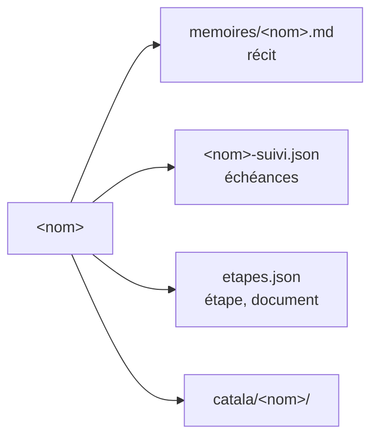

# Suivi du dossier

Le suivi relève les étapes d'un dossier qu'il ne faut pas manquer. Il se distingue du programme Catala : le programme raisonne dans un acte (`.piecemaker/catala/<nom>/`, plusieurs par dossier), le suivi liste les dates qui comptent pour le dossier (`.piecemaker/<nom>-suivi.json`, un fichier par acte ou procédure suivi, `suivi.json` reste valide). Ce n'est pas une chronologie : n'y entrent que les actes à valeur procédurale (contentieux) et les dates liées à la validité du contrat (contrat), avec les échéances qui en découlent.

## Avec un brain : les goals

Avec un brain, chaque dossier a `goals/<goal>/` dans le brain. Un goal est un acte à produire ou une procédure à mener ; il contient un ou plusieurs actes.

| Fichier | Contenu | Écrit par |
|---|---|---|
| `Goal.md` | l'objectif (200 lignes, sans frontmatter) | l'agent, l'avocat (onglet Contexte) |
| `Memory.md` | stratégie, décisions, consignes, fait et à faire (200 lignes, sans frontmatter) | l'agent, l'avocat |
| `Archive.md` | ce qui ne sert plus (sans limite) | l'agent, l'avocat |
| `Timeline.json` | `actes` (étape, versions), `evenements`, `echeances`, `matter` | l'avocat (actes), l'agent (le reste) |

Le goal `principal` répond à `suivi.json`, un goal `<g>` à `<g>-suivi.json` : le moteur, le Matter board et `pm suivi_dossiers --suivi` gardent ces noms. Une nouvelle version d'acte (`-vN`, `precedent`) reste dans le goal de son acte. Le tableau ci-dessous décrit le fonctionnement sans brain.

## Mémoire projet, suivi et étapes : une place par information

La règle 4° de l'`AGENTS.md` livré dans chaque dossier (`server/piecemaker/agent-instructions.ts`) fait tenir à l'agent une mémoire par projet. Un projet est un acte précis ; son `<nom>` est la clé commune du programme Catala, du suivi, de la carte du tableau et de la mémoire.

| Information | Source unique | Écrite par | Lue par |
|---|---|---|---|
| Récit (décisions, consignes, travail fait et à faire) | `.piecemaker/memoires/<nom>.md`, Markdown sans frontmatter | l'agent | l'agent |
| Échéances, événements, prochaine action | `.piecemaker/<nom>-suivi.json` | l'agent, le Matter board | `pm suivi_dossiers`, Matter board, tableau (`nextAction`) |
| Étape en cours, document à produire (type → skill et modèle de `types-documents.json`) | `.piecemaker/etapes.json` (`raisonnements.<nom>`) | l'avocat, sur le tableau (`etapes.ts`) | tableau, `pm check` |
| Chemin de la mémoire | déduit de `<nom>` | — | — |
| Date de mise à jour de la mémoire | date de modification du fichier (`.piecemaker/` est hors de l'historique Git du dossier) | le système de fichiers | `ls -l` |



L'ancienne règle 4° (mémoire libre, référencée dans l'`AGENTS.md`, frontmatter avec template, échéances et étape) est remplacée dans chaque `AGENTS.md` au démarrage, si la ligne n'a pas été modifiée. Une mémoire existante n'est pas migrée par le code : son emplacement et son format étaient libres. `pm memoire verifier` refuse le frontmatter et dit où reporter chaque donnée ; l'agent déplace le récit dans `.piecemaker/memoires/<nom>.md`.

`pm memoire verifier [--memoire NOM]` (local, sans serveur) signale :

- erreur : `<fichier>:1: erreur : pas de frontmatter. …` ;
- manque : aucun programme Catala, suivi ni carte du tableau ne porte ce nom ;
- `--memoire` sur un fichier absent : `introuvable`.

Une mémoire conforme ne produit aucune sortie. Le Hérisson lance la vérification après chaque écriture (feature `memoire`, `docs/Le-Herisson.md`).

`matter.stage` du suivi reste la phase libre affichée par le Matter board ; l'étape du travail est celle d'`etapes.json`.

## Fichier

JSON : `{ matter, evenements, echeances }`. Une faute de syntaxe ressort à sa ligne. Les clés inconnues ou mal placées sont refusées dans `evenements` et `echeances`.

- `matter` : fiche de l'affaire sur le tableau (`name`, `client`, `practiceArea`, `responsible`, `status`, `stage`, `openedOn`, `summary`, `parties`, `nextStep`, `links`, `via`) et champs réservés à l'avocat.
- `matter.keyDates` : l'agent ne l'écrit jamais. La liste garde les dates manuelles de l'avocat, signalées en manque, et les champs du tableau (`confirmed`, `phase`, `page`, `docId`) des dates vérifiées.
- `evenements.<nom>` : `date`, `preuve: [{ piece, citation }]` ou `hypothese: true` (acte non signé), `selon` facultatif, `intitule` facultatif.
- `echeances.<nom>` : `intitule`, `kind` (`limitation`, `hearing`, `filing`, `other`), puis
  - date fixée : `date` + `preuve` (ou `selon`) ;
  - date calculée : `de` (après) ou `avant` (à rebours), `delai` (`jours`, `jours_ouvres`, `mois`, `ans`), `selon`, `decompte: { depart: exclu|inclus, report: jour_ouvrable_suivant|jour_ouvrable_precedent|aucun, selon }`, `prolongation: { delai, selon }` facultative ;
  - `fait: { date, preuve }` facultatif.

Migration : à la première lecture, un ancien `.piecemaker/suivi.yaml` devient `suivi.json` avec une fiche vide. L'ancien fichier est renommé `suivi.yaml.migre`, jamais supprimé.

Aucune règle de droit n'est codée : le moteur applique les réglages déclarés et exige que chacun soit justifié par une source citée. Il connaît seulement le calendrier (samedis, dimanches, jours fériés de métropole ; mois de quantième à quantième, dernier jour du mois à défaut).

## Vérification

`server/modules/piecemaker-suivi/suivi.ts` (`verifySuivi`), calendrier dans `calendar.ts`.

- Erreurs : syntaxe et clés, référence `de`/`avant` inconnue, boucle, délai ou prolongation sans `selon`, date fixée sans preuve ni source, date écrite différente du calcul, pièce introuvable, citation introuvable, source sans identifiant officiel, version non en vigueur à la date de départ, décision remise en cause.
- Manques : date d'événement non prouvée, citation qui ne montre pas la date, décompte absent ou non fondé, `depart`/`report` manquant, événement sans portée (ni échéance ni `selon`), accomplissement non prouvé, échéance dépassée non marquée faite, historique judiciaire à examiner, source sans connecteur.

Les sources passent par les mêmes connecteurs que `pm catala` (Légifrance, pièces du dossier).

## Service, commandes, onglet

- `suivi-service.ts` : tables `pm_suivi(project_id, fichier, revision, code, snapshot_json)` et `pm_suivi_faits(project_id, fichier, echeance, date, piece, at)`, créées et migrées au démarrage (l'ancienne ligne devient `fichier = suivi.json`) ; la lecture revérifie quand le fichier a changé (empreinte sha256).
- `suivi-board.ts` : présente chaque fichier de suivi au tableau unique « Dossiers » comme `projects/cabinet/matters/dossier-<sha16>`. Un dossier sans fichier de suivi n'y figure pas. La page ouvre directement ce tableau et affiche ses actions en boutons. Le serveur et la page refusent tout ajout manuel de dossier. Les autres documents (tableau, étapes, activité, demandes, documents déposés) vont dans la table `pm_board_docs(path, data_json)`.
- Écriture depuis le tableau : `matter` va dans le fichier. Une date vérifiée va dans `evenements` ou `echeances`. Une case cochée va dans `pm_suivi_faits`. Une suppression de carte renomme le fichier en `<fichier>.supprime`.
- Routes `/api/piecemaker/suivi` (`GET /`, `GET /tous`, `POST /verify`), `/api/piecemaker/suivi/board` (`GET ?rev=`, `POST { op, path, data, base }`) et route locale `/suivi` pour `pm suivi_dossiers verifier|lire|ecrire` et l'outil MCP `suivi`.
- Onglet Suivi des dossiers (`plugins/piecemaker-echeances`), trois vues : Tableau, Tâches, Échéances (voir « Tableau et tâches »). Les trois vues reprennent le style du Matter board : mêmes jetons (couleurs, polices, rayons) et mêmes composants (boutons, puces, colonnes, cartes, onglets segmentés), en clair et en sombre, dans `src/styles.ts`. Échéances : un bandeau (erreurs, manques, dates à établir, Revérifier, Ouvrir le dossier) et le Matter board dans une iframe Blob. `src/board-shim.ts` remplace `window.claude.use('db')` par ces routes, avec relecture toutes les 2 s tant que la vue est affichée, sans requête cumulée.
- État des dossiers : le bouton « Rédiger un état des dossiers » du bandeau insère la consigne dans le chat, sans l'envoyer (événement `piecemaker:composer-insert`, écouté par `piecemaker-context-suggestions`). La skill piecemaker en donne la méthode. La page n'affiche plus de ligne d'attente pour une demande ouverte.

## Tableau et tâches

Service `server/modules/piecemaker-suivi/etapes.ts`, routes `/api/piecemaker/etapes`. État par dossier dans `.piecemaker/etapes.json` ; types de documents dans `<data root>/types-documents.json`, modèles dans `<data root>/modeles-documents/` ; file de tâches centrale dans `<data root>/todo.json` (`taches.ts`).

- Vue Tableau (`src/tableau.ts`), une carte par programme Catala, colonnes vides masquées. Chaque colonne a un but ; la carte montre où en est ce but et un seul bouton, l'action qui fait avancer la carte (masqué tant qu'une tâche de la carte est en file ou en cours). Elle affiche aussi le nom du dossier, la pastille de nature, l'acte, le premier objectif (« +N » s'il y en a d'autres) et l'alerte d'échéance. Le panneau reprend ce bouton avec les actions secondaires (`colonne()` décrit les deux).
  - Titre : `tache` de `tache.json` du programme Catala, sinon son nom. Le programme ne donne ni nature ni acte : la pastille de nature et l'acte restent vides.
  - Préparation dossier (but : rendre les pièces exploitables) : dossiers sans raisonnement ni étape choisie, en échec à la vérification de préparation (`etatDossier` de `pm.mjs` : anonymisation, index, conversion) ou au mapping non validé. Un scan postérieur à la validation (`scanned.updatedAt` de `.piecemaker/anonymization-state.json`) l'annule, côté serveur comme dans `pm`. État : « Anonymisation faite / à faire · Index fait / à faire » ; l'anonymisation comprend la conversion des pièces protégées, la pseudonymisation et le mapping validé. Bouton : l'étape suivante, « Lancer l'anonymisation », puis « Valider le mapping » (le volet Dossier s'ouvre sur le mapping, `__piecemakerMappingShow`, événement `piecemaker:mapping-show`, dont le bouton du bas écrit `mappingValide` dans `.piecemaker/etapes.json`), puis « Lancer l'index ». Panneau : « Ouvrir les pièces », « Ouvrir l'index » une fois fait, « Démarrer le raisonnement » sans raisonnement. Une vérification en échec garde le dernier état valide, enregistré dans `etats-dossiers.json` du dossier de données ; sans état connu, pas de bouton. Menu « Non juridique » à toutes les étapes, même sans raisonnement. L'étape choisie est conservée : une préparation incomplète ne bloque ni le raisonnement ni les étapes suivantes. La case « Afficher les exclus » (légende au survol), à droite du titre de la colonne, n'y affiche que les dossiers exclus ; un dossier exclu n'est plus vérifié.
  - Raisonnements (but : un programme Catala vérifié, `resultats/verification.json`) : « À démarrer » → « Démarrer le raisonnement » ; non vérifié → « Vérifier le raisonnement » ; « N erreurs · M manques » → « Lever manques et erreurs », la liste des alertes est dans le panneau ; vérifié sans alerte → « Valider le raisonnement ». Avec des manques et sans erreur, le panneau propose « Valider malgré tout », qui rappelle les manques restants.
  - Rédaction (but : le document .docx) : documents choisis parmi les types (skills `redaction-*` de la Bibliothèque et types ajoutés avec modèle). Le skill est activé dans le dossier pour toutes les IA ; s'il manque, l'IA le crée et la Bibliothèque est rescannée en fin de tâche. Sans document rédigé : « Rédaction non commencée » et « Lancer la rédaction » (choix du type et du nom, puis lancement). Document rédigé : son nom, et « Valider la rédaction » ; le panneau l'ouvre d'un clic. Un document choisi mais non rédigé se lance ou se retire depuis le panneau.
  - Finalisation (but : relire, puis envoyer ou déposer) : « Valider la finalisation » demande explicitement « En attente de tiers » ou « Plus d’étape ni d’attente : clore ». En attente de tiers (but : suivre ce que l'on attend) : l'attente (« À faire » / « Effectué ») ; bouton « + Document du tiers », qui copie le document reçu dans `Pièces/`, crée une nouvelle version du programme Catala (l'ancienne et ses documents restent) et une tâche de reprise. La relance automatique est cochée par défaut ; décochée, la tâche reste manuelle. Chaque nouveau document reçoit un chemin sans collision avec les anciennes versions. Le panneau modifie l'attente, la marque effectuée et propose « Clore ». Une attente effectuée ne clôt jamais automatiquement le dossier.
  - Clos (archive) : documents et programme Catala à ouvrir depuis le panneau. Le menu « ⋯ » déplace une carte vers toute étape, après confirmation.
  - Code couleur du Matter board (`src/attention.ts`, mêmes règles et seuils) : bordure orange (attention) ou rouge (urgent) et une pastille avec l'alerte la plus urgente, d'après la fiche du dossier. Un dossier exclu n'en a pas.
- Chargement instantané, sans bouton Actualiser :
  - Le serveur garde en mémoire l'état de préparation de chaque dossier (`etatDossier`) et répond sans le recalculer. Sans état connu, les pastilles restent vides, sans message d'attente.
  - L'état est recalculé en arrière-plan, un dossier à la fois : au démarrage, 2 s après un changement dans le dossier (observateur de `folder-history`, hors `.git`), après une action du tableau, et au plus tard toutes les 5 min.
  - La ligne Conversion ne liste que les 10 premières pièces non converties.
  - La vue garde le dernier tableau dans `localStorage` (`pme-tableau`) et l'affiche dès l'ouverture. Elle se relit toutes les 5 s, sans lancer une requête tant que la précédente n'a pas répondu.
- Fenêtre de lancement commune (`src/lancer.ts`) : IA, modèle, consignes, case « automatique » cochée par défaut. Le modèle préféré est retrouvé par famille (`matchModel`, `mistral-medium-latest` ↔ `mistral-medium-3.5`).
- Vue Tâches (`src/taches.ts`) : Automatiques (une à la fois), Manuelles, Terminées. « Lancer immédiatement » passe la file.
- Questions des tâches : le prompt demande à l'IA de finir par une ligne « Question : … » quand l'avocat doit décider. La tâche passe alors au statut `question`, en colonne Questions : « Répondre » relance un tour dans la même session, « Terminer » la clôt. Pendant un tour, les demandes en attente de la session (AskUserQuestion, ExitPlanMode, autorisation d'outil) s'affichent sur la carte et se règlent depuis la vue (routes `repondre`, `decision`, `terminer`).
- Panneau du dossier, commun aux trois vues : un clic sur une carte du Tableau, une tâche ou une carte du Matter board (Échéances) ouvre le même tiroir à droite. Le clic sur le Matter board est intercepté : son propre panneau ne s'ouvre plus.
  - Style de `docs/Design_Rule.md` : panneau flottant `rounded-2xl` en verre, police Inter (titres compris), boutons `rounded-full` de 28 px (principal en noir), anneau de focus bleu.
  - En-tête : nom du dossier, acte en titre (sinon nom du dossier), pastille de nature.
  - Sections : la colonne courante (état, alertes, actions), Parties (noms et rôles de `matter.parties`, en clair, depuis le disque), Document à produire, Objectifs (tous), Versions précédentes.
  - Versions précédentes, après « + Document du tiers » : chaque ancienne version ouvre son programme Catala et ses documents.
  - En dessous, quand le dossier a un suivi, la fiche du dossier en lecture seule : résumé, client, domaine, responsable, prochaine action, dates clés. Elle vient de `GET /api/piecemaker/suivi/board` (relu avec `?rev=`, seulement quand le panneau est ouvert), sans charger le Matter board. Le serveur donne l'identifiant de fiche de chaque carte (`matter`). La fiche se modifie dans la vue Échéances.
- « Ouvrir le programme Catala » pose `window.__piecemakerCatalaShow`, émet `piecemaker:catala-show` et ouvre le volet Catala sur ce programme. Un autre dossier s'ouvre via sa dernière conversation.

## Page du tableau

`plugins/piecemaker-echeances/board/index.html` est une copie du Matter board, adaptée par `scripts/piecemaker/adapter-matter-board.mjs` :

```sh
node scripts/piecemaker/adapter-matter-board.mjs <page-source.html> plugins/piecemaker-echeances/board/index.html
```

Le script retire le bloc de coût et l'ajout de dossiers ou de tableaux, remplace les notes pour Claude par des renvois à `pm suivi_dossiers` et aux références de l'outil Feature, ajoute la lecture des dates écrites en français et traduit l'interface avec la table `scripts/piecemaker/matter-board-fr.mjs`. Chaque motif doit être unique, sinon le script échoue. Une entrée de la table déclare son nombre d'occurrences. Les valeurs stockées (`status`, `kind`, `role`) restent en anglais. La page n'a pas de licence publiée : l'utilisateur a décidé de l'intégrer et assume ce point. `manifest.piecemakerAssets` la fait copier par la chaîne de plugins (`docs/plugins.md`).

## Limites

- Jours fériés de métropole seulement.
- « Ouvrir le dossier » exige une conversation existante dans le dossier ; il est dans le bandeau, pas sur la carte.
- Pas de notification système : l'onglet est le seul rappel.
- Polices d'origine absentes (`/_runtime`), remplacées par celles du système.
- Le tableau montre tous les dossiers : plus de portée « Ce dossier ».
- Les capacités de la page hors `db` renvoient `null` : ses boutons d'agent copient un texte à coller dans le chat.
